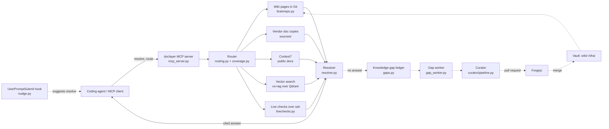
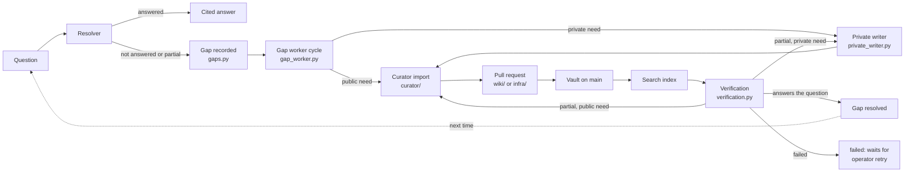

# vo-brain

A Git-backed knowledge base that coding agents can query, with every answer cited, and that writes its own missing pages.

[](https://github.com/Buckeyes22/vo-brain/actions/workflows/ci.yml)

[](LICENSE)

## What it is

vo-brain is a markdown wiki (it opens as an Obsidian vault) that agents read and write under a frontmatter contract with a mandatory `privacy:` field.
Next to it sits `doclayer`, a Python package that answers questions by joining four kinds of evidence: wiki pages read from Git, copies of vendor docs, vector search, and read-only live checks.
Each fact in an answer carries its source and date, such as `path@commit`, `URL@fetch-date`, `Context7` or `live check @ time`.
When a question has no answer, it becomes a tracked knowledge gap.
An LLM curator, or an allowlisted read-only command runner, then fills the gap with a cited page that lands through a pull request.

The vault in this repository is a small fictional demo: hosts `ws1`, `app1`, `gpu1`, `svc1`, `worker1`, `nas1` and a product called `example-cli`.

## System overview



Solid arrows are the answering path. Dotted arrows are the background path that fills gaps.

## A brain that fills its own gaps

Every question the brain cannot fully answer becomes a knowledge gap in a durable ledger, deduplicated so a repeated question raises its count instead of adding a record.
A background worker runs every five minutes and researches each open gap.
A public-documentation gap goes to the LLM curator with official sources found by bounded discovery.
A question about the operator's own machines is answered from allowlisted read-only commands run over ssh, with any output that looks like a secret withheld whole.
The result is a cited page that lands as a pull request in `wiki/` or `infra/`.
The worker then checks that the new page, once indexed, actually answers the original question, and only then closes the gap.
The next time anyone asks, the answer comes from that page, with its source and date.



The full trace, with the function behind every step, is in [docs/knowledge-loop.md](docs/knowledge-loop.md).

## Features

- **Cited answers.** One `resolve` call returns flags, facts with sources and dates, and a list of checked and skipped sources. See [docs/resolver.md](docs/resolver.md).
- **Self-filling gaps.** Unanswered questions become gaps that a worker researches, fills, publishes and verifies. See [docs/knowledge-loop.md](docs/knowledge-loop.md) and [docs/gap-worker.md](docs/gap-worker.md).
- **Selective routing.** A deterministic router decides which sources a question needs, with no model call. A prompt hook suggests a lookup only when one is justified. See [docs/agent-integration.md](docs/agent-integration.md).
- **Unattended curation with guarantees.** The curator turns sources into wiki edits that keep existing text, cite their evidence and pass deterministic checks before they publish. See [docs/curator.md](docs/curator.md) and [docs/curator-quality.md](docs/curator-quality.md).
- **Declared vs observed.** Live checks sit next to what a page declares, and a disagreement shows as a flag. See [docs/resolver.md](docs/resolver.md#declared-vs-observed).
- **Vendor doc copies.** A fetcher keeps Markdown copies of vendor pages where Context7 is thin, and rejects login pages and soft 404s. See [docs/doc-fetcher.md](docs/doc-fetcher.md).
- **Durable jobs.** Curator jobs and gap records live on the filesystem, survive restarts and resume at their last checkpoint. See [docs/reliability.md](docs/reliability.md).
- **One model endpoint, per-stage overrides.** Any OpenAI-compatible endpoint, with an idle gate for a shared local GPU server. See [docs/models.md](docs/models.md).
- **Safe vault sync.** Registered clones fast-forward on a timer and never lose local edits. See [docs/vault-sync.md](docs/vault-sync.md).

## Quickstart

You need Python 3.12 and [uv](https://docs.astral.sh/uv/). Everything below runs against the demo vault in this repository and needs no network service.

```bash
git clone https://github.com/Buckeyes22/vo-brain.git
cd vo-brain/doclayer
uv sync
uv run pytest -q -p no:cacheprovider 2>&1 | tail -2
```

The full suite reported `4244 passed in 251.46s` when these docs were written.

Start the MCP server against this repository. It speaks MCP over stdio:

```bash
DOC_LAYER_BRAIN_REPO=.. uv run doclayer-mcp
```

The resolver treats only the vault as evidence: it skips `README.md`, `CLAUDE.md`, `LICENSE`, `docs/`, `doclayer/` and `.github/` both when it reads pages from Git and when it takes hits from the search index, so these docs never appear as sources in its answers.

Register it in an MCP client. For Claude Code, add this to `.mcp.json` (adjust the path):

```json
{
  "mcpServers": {
    "doclayer": {
      "command": "uv",
      "args": ["run", "--directory", "/path/to/vo-brain/doclayer", "doclayer-mcp"],
      "env": { "DOC_LAYER_BRAIN_REPO": "/path/to/vo-brain" }
    }
  }
}
```

Then ask a question, for example "Which port does Postgres listen on for the example app on app1?".
The block below is real output, trimmed. It was produced offline against this checkout by calling `doclayer.resolver.resolve` (the function behind the MCP `resolve` tool), with the vector search and Context7 URLs pointed at a closed local port:

```text
# Answer: Which port does Postgres listen on for the example app on app1?

**Flags**
- ⚠ index state unknown: brain_sync has never run or its state file is missing

## Answer

**Fleet hosts (source extract with full context) — infra/fleet-hosts.md@<commit> · page text · recorded 2026-10-12**
...
> - **app1** — `192.0.2.20` application and GPU inference VM. Debian 12. Serves an OpenAI-compatible inference endpoint on port 8000 and a Postgres 16 database on port 5432 for the example app ([[wiki/example-app-deployment]]).
...

## Search (vo-rag over vo_rag_brain_v1)

- unavailable: ConnectError: All connection attempts failed

## Context7

- library: n/a
- result withheld: requested applicability or facts are not established

## Dispositions

- outcome: answered, index_lag, source_unavailable
- checked sources: brain_git, brain_index
- skipped public_docs: local/private question; public documentation cannot establish local facts
```

The answer cites the page and the commit it was read at; the real output carries the first eight characters of the commit hash where the block shows `<commit>`. The vector search was down, so the answer says so, but the Git facts still came through. Context7 was skipped because the question is about a local host.

## Repository layout

```text
vo-brain/
├── README.md        this file
├── CLAUDE.md        guide for AI coding agents working on this repository
├── LICENSE          MIT
├── index.md         root map of the vault
├── log.md           librarian activity log
├── wiki/            curated pages (demo content)
├── infra/           fleet of record: hosts and roles (demo content)
├── sources/         Markdown copies of vendor docs, one folder per product
├── inbox/           staging area for proposed pages before review
├── templates/       the page template and its frontmatter contract
├── docs/            documentation for the system
└── doclayer/        the Python package
    ├── src/doclayer/          resolver, routing, gap loop, fetcher, vault sync
    ├── src/doclayer/curator/  the wiki curator
    ├── tests/                 the test suite
    ├── recipes/               doc-fetcher recipes
    ├── examples/              example local evidence profiles
    ├── deploy/                systemd units, timers and install scripts
    └── routing-policy.yaml    aliases and source relationships for the router
```

## Documentation

| Page | What it covers |
|---|---|
| [docs/architecture.md](docs/architecture.md) | Components, every module's role, dependencies, where state lives |
| [docs/resolver.md](docs/resolver.md) | How one question becomes one cited answer |
| [docs/knowledge-loop.md](docs/knowledge-loop.md) | How unanswered questions become published, verified pages |
| [docs/gap-worker.md](docs/gap-worker.md) | Operating the gap worker: commands, timers, settings, troubleshooting |
| [docs/agent-integration.md](docs/agent-integration.md) | The prompt hook and MCP tools that coding agents use |
| [docs/doc-fetcher.md](docs/doc-fetcher.md) | How vendor docs enter `sources/` |
| [docs/curator.md](docs/curator.md) | The curator pipeline, job states and runbook |
| [docs/curator-quality.md](docs/curator-quality.md) | Why unattended publishing is safe |
| [docs/reliability.md](docs/reliability.md) | Durable jobs, budgets, transport and crash recovery |
| [docs/models.md](docs/models.md) | The model client, per-stage overrides and the idle gate |
| [docs/vault-sync.md](docs/vault-sync.md) | How merged pages reach every machine |
| [docs/testing.md](docs/testing.md) | Test strategy, fakes and fixtures |
| [docs/design-decisions.md](docs/design-decisions.md) | Design decisions and a glossary |
| [docs/vault-format.md](docs/vault-format.md) | Vault layout, frontmatter schema and promotion flow |
| [docs/configuration.md](docs/configuration.md) | Every environment variable and config key, deployment topology |
| [docs/mcp-tools.md](docs/mcp-tools.md) | Every MCP tool with arguments and examples |
| [docs/security-model.md](docs/security-model.md) | Command allowlist, secret handling, trust boundaries |
| [docs/development.md](docs/development.md) | Setup, tests, adding recipes and profiles |

## Design principles

- Every fact carries a source and a date. An answer that cannot cite something says "unknown".
- What a page declares and what a live check observes stay separate, and a disagreement is a flag.
- Privacy fails closed: the page contract treats a page with no `privacy:` line as `sensitive`, and the curator rejects a page without a valid one.
- Private evidence comes only from allowlisted read-only commands. Model output never reaches a shell.
- Every input is bounded: prompt size, command output, sources per job, model calls per job.
- A source that is down degrades the answer and is named in it. It never blanks the answer.
- Git is the source of truth. The vector index is a rebuildable copy for fuzzy search.
- A missed lookup is a fact about the lookup, never a fact about the subject.

## Development

```bash
cd doclayer
uv sync
uv run pytest -q -p no:cacheprovider 2>&1 | tail -2   # full suite
uv run pytest -q tests/curator 2>&1 | tail -2         # curator tests only
uv run ruff check . && uv run ruff format --check .  # lint and format gate
```

CI also gates lint and format: it runs `uv run ruff check .` and `uv run ruff format --check .` from `doclayer/` (rules E4, E7, E9, F and I, line length 120, configured under `[tool.ruff]` in `doclayer/pyproject.toml`; ruff is in the dev group). Run both before opening a pull request. See [docs/development.md](docs/development.md) for the test layout and how to add a fetch recipe or a local evidence profile.

## License

MIT. See [LICENSE](LICENSE).
