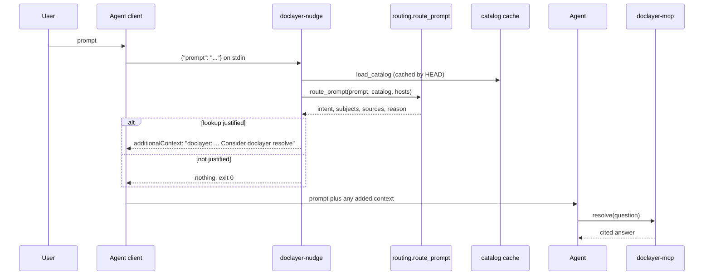

# Agent integration

Coding agents use the brain in two ways. A prompt hook reads every prompt and, when a lookup is justified, adds one line of context that suggests calling `resolve`. The MCP tools let the agent ask directly. Neither path needs the agent to be told about the brain in advance.

## Contents

- [The prompt hook](#the-prompt-hook)
- [What the hook decides](#what-the-hook-decides)
- [Latency](#latency)
- [Suppression and bypasses](#suppression-and-bypasses)
- [Installing the hook](#installing-the-hook)
- [The MCP tools](#the-mcp-tools)
- [Read discipline](#read-discipline)

## The prompt hook

`doclayer-nudge` (`nudge.py`) is a `UserPromptSubmit` hook. The agent's client runs it before each prompt and passes the prompt as JSON on stdin.



The hook never blocks a prompt. It skips slash commands and prompts over 20,000 characters, and any error exits 0 with no output (`nudge:main`).

## What the hook decides

`routing:route_prompt` classifies the prompt deterministically against the coverage catalog (see [resolver.md](resolver.md#routing)). `nudge:suggestion_for` prints a line only for the intents `local_environment`, `public_docs` and `mixed_local_public`:

- **A known subject.** Real output for "How do I roll back the example app on app1?" against the demo vault:

  ```json
  {"hookSpecificOutput": {"hookEventName": "UserPromptSubmit", "additionalContext": "doclayer: app1 is a known host; route: brain_git, brain_index. private factual context; consult local declarations and evidence, not public documentation Consider doclayer `resolve` before answering."}}
  ```

- **An uncovered subject.** A clear documentation request that names something the catalog does not know prints: "doclayer: '<name>' is not in the brain catalog — use external documentation and record the need with doclayer `record_gap`." It also records a lightweight gap candidate (`nudge:_record_uncovered_candidate`) with `defer=True`, which only writes the local outbox.
- **Code work, ambiguous prompts, and subject mentions without a documentation need** print nothing. "Refactor this function" against the demo vault produced no output.

The hook makes no model call and no network call. The catalog is read from a cache keyed by the vault's `HEAD`, and ssh host aliases from a separate cache.

## Latency

The hook has no configurable time budget. `tests/test_routing_evaluation.py:test_hook_warm_path_under_budget` checks the classify step, asserting an average under 5 ms per prompt over the evaluation set.

Measured on the demo vault while writing these docs (warm caches, the package's own `.venv`):

| What | Time |
|---|---|
| `routing.route_prompt`, mean of 200 calls | 0.149 ms |
| `routing.load_catalog` from cache, mean of 20 calls | 1.16 ms |
| Whole `doclayer-nudge` process, three runs | 81 ms, 67 ms, 71 ms |

Most of the process time is Python start-up and imports.

## Suppression and bypasses

When a recent lookup for the same question and subject already failed, the hook appends the negative-cache status to its line: "recent lookup did not answer this request (date; checked ...)". This tells the agent that repeating the lookup is unlikely to help. It is a fact about the lookup, never about the subject.

Three things bypass suppression:

- `resolve(force=True)` ignores the negative cache for that call.
- `route(question, explicit=True)` routes the question as an explicit brain lookup.
- An explicit lookup still runs a bounded search when the catalog does not list the subject, instead of refusing.

## Installing the hook

Install the package first (`cd doclayer && uv sync`). Then register the hook in Claude Code's settings, for example `~/.claude/settings.json`:

```json
{
  "hooks": {
    "UserPromptSubmit": [
      {
        "hooks": [
          {
            "type": "command",
            "command": "/path/to/vo-brain/doclayer/.venv/bin/doclayer-nudge"
          }
        ]
      }
    ]
  }
}
```

The hook reads the vault from `DOC_LAYER_BRAIN_REPO`, or from the pointer file `~/.config/doclayer/brain-repo`, or from `~/brain` when neither exists (`settings.Settings.brain_repo_selection`). Point it at a clone that a timer keeps current, not at a checkout you edit (see [vault-sync.md](vault-sync.md)).

Any client that supports a prompt-submit hook with JSON on stdin and `hookSpecificOutput.additionalContext` on stdout can use the same command.

## The MCP tools

`doclayer-mcp` exposes four tools: `resolve`, `route`, `record_gap` and `attach_source`. `brain-curator-mcp` exposes eight curator tools. Arguments, return shapes and examples are in [mcp-tools.md](mcp-tools.md).

A typical sequence:

1. The hook suggests a lookup.
2. The agent calls `resolve` and gets a cited answer.
3. If the answer is not enough and the agent finds documentation elsewhere, it calls `attach_source` with the URL, so the gap worker can reuse it.
4. If the agent meets a need it cannot meet, it calls `record_gap`.

## Read discipline

The vault is cheap to read if agents read only what they need:

1. Start at `index.md`, the root map, then the area hub (`wiki/index.md`, `infra/index.md`).
2. Find the page, look at its headings, and read only the section that holds the answer. The resolver works the same way: it quotes the whole section that governs a fact, with its parent headings, and never clips one.
3. Treat `[[wikilinks]]` as lazy. A link to a page that does not exist yet marks something to write later, not an error. Follow only the links the task needs.
