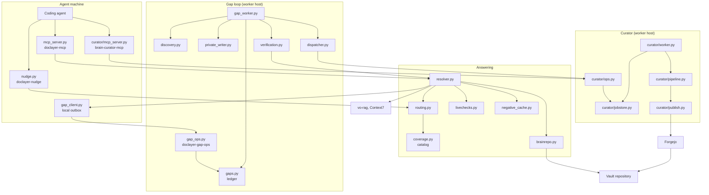
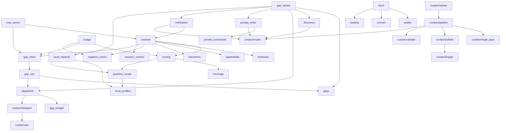

# Architecture

This page maps the system: its components, every module in the `doclayer` package, how the main modules depend on each other, and where each piece keeps its state. The other pages in [docs/](../README.md#documentation) explain each part in depth.

## Contents

- [Components](#components)
- [Component diagram](#component-diagram)
- [Modules and responsibilities](#modules-and-responsibilities)
- [Dependency graph](#dependency-graph)
- [Where state lives](#where-state-lives)
- [Where things run](#where-things-run)

## Components

The system has two halves. The **vault** is a Git repository of Markdown pages. The **doclayer** package reads the vault, answers questions, and writes new pages back through pull requests.

| Component | Entry point | Job |
|---|---|---|
| Resolver | `doclayer-mcp` tool `resolve` | One question in, one cited answer out |
| Router and coverage catalog | `routing.py`, `coverage.py` | Decide which sources a question needs, with no model call |
| Prompt hook | `doclayer-nudge` | Suggest a lookup to a coding agent when one is justified |
| Knowledge-gap ledger | `gaps.py`, `doclayer-gap-ops` | Durable record of every unanswered question |
| Gap worker | `doclayer-gap-worker` | Research, dispatch and verify gaps every five minutes |
| Private writer | `private_writer.py` | Gather allowlisted read-only evidence for questions about the operator's machines |
| Curator | `brain-curator`, `brain-curator-worker`, `brain-curator-mcp` | Turn sources into validated wiki edits and publish them |
| Doc fetcher | `doclayer-fetch` | Keep Markdown copies of vendor docs in `sources/` |
| Vault sync | `brain-vault-sync` | Fast-forward registered clones of the vault |

Two services sit outside this repository. **vo-rag** is a vector search API over a Qdrant collection named `vo_rag_brain_v1`; its indexer polls the vault's `main` branch. **Context7** is a public documentation service reached over MCP. Both are optional: the resolver answers from Git when they are down and says so.

## Component diagram

## Modules and responsibilities

The package has 63 modules (33 in `doclayer/src/doclayer/`, 30 in `doclayer/src/doclayer/curator/`, not counting the two `__init__.py` files).

### Answering

| Module | Role |
|---|---|
| `mcp_server.py` | The `doclayer-mcp` stdio server with four tools: `resolve`, `route`, `record_gap`, `attach_source` |
| `resolver.py` | Plans sources, queries them in parallel, ranks Git facts, renders the answer and records misses |
| `resolver_context.py` | Delivers evidence whole or not at all, within character limits per unit and per answer |
| `routing.py` | Deterministic route decision per prompt: intent, subjects, sources, gap-capture eligibility |
| `coverage.py` | Builds the coverage catalog from committed pages and the routing policy; caches it by `HEAD` |
| `applicability.py` | Recognizes hosts and subjects and matches a question's scope (platform, edition, version) to a source's scope |
| `question_scope.py` | Separates public product questions from questions about a private installation |
| `brainrepo.py` | Reads pages, frontmatter and Facts tables from Git at a fixed commit |
| `frontmatter.py` | Splits and builds YAML frontmatter |
| `livechecks.py` | Read-only checks of running state (ssh, HTTP GET, file read), each tagged with its time |
| `negative_cache.py` | Remembers recent unsuccessful lookups for six hours so the same miss is not repeated |
| `settings.py` | Every `DOC_LAYER_*` setting, read from the environment |

### Agent integration

| Module | Role |
|---|---|
| `nudge.py` | The `UserPromptSubmit` hook: prints one suggestion line or nothing, never blocks |
| `gap_client.py` | Client side of the gap ledger: local outbox, then local or ssh delivery to the owner |

### Knowledge-gap loop

| Module | Role |
|---|---|
| `gaps.py` | The durable ledger: one record per need, event trail, states, leases, backoff |
| `gap_ops.py` | `doclayer-gap-ops`: fixed JSON-on-stdin operations on the owning host |
| `gaps_cli.py` | `doclayer-gaps`: operator commands (status, list, retry, suppress, verify, flush and more) |
| `gap_worker.py` | `doclayer-gap-worker`: the five-minute cycle |
| `discovery.py` | Bounded search for official documentation for a public need |
| `dispatcher.py` | Submits ready gaps to the curator in durable slots; resumes or retires stopped jobs |
| `gap_budget.py` | Records attempt grants and model-call charges before any I/O |
| `verification.py` | Closes a gap only when an indexed page provably answers the original question |
| `local_material.py` | Decides whether a need is local, using the operator's profiles and the built-in rules |
| `local_profiles.py` | Loads and validates the operator's local evidence profiles from YAML |
| `private_writer.py` | Has the model plan allowlisted commands for a private need, runs them, stores the outputs |
| `private_commands.py` | The command allowlist, the secret detector and the ssh runner |
| `curator_reply.py` | Strict parsers for curator replies on the ops wire |
| `gap_migration.py` | Offline move of the ledger to a new owning host |

### Doc fetcher and vault sync

| Module | Role |
|---|---|
| `fetch.py` | `doclayer-fetch`: refresh `sources/<product>/` from a recipe |
| `convert.py` | HTML to Markdown for fetched pages |
| `quality.py` | Rejects HTTP errors, soft 404s, login pages and near-empty pages |
| `landing.py` | Commits a refresh to a branch, opens a pull request, self-merges only a clean `sources/`-only change |
| `vault_sync.py` | `brain-vault-sync`: fast-forwards registered clones and protects local edits |

### Curator

| Module | Role |
|---|---|
| `curator/cli.py` | `brain-curator`: submit, status, result, resume, continue, cancel, correct, list, inspect, ops |
| `curator/mcp_server.py` | `brain-curator-mcp`: the same operations as eight MCP tools |
| `curator/transport.py` | Reaches the worker host over ssh, or the local job store directly |
| `curator/ops.py` | The JSON-on-stdin operations dispatcher on the worker host |
| `curator/config.py` | Every curator config key, the YAML loader and per-stage model overrides |
| `curator/state.py` | Versioned job state: job, change and source statuses and stages |
| `curator/jobstore.py` | The filesystem job store with atomic writes and file locks |
| `curator/worker.py` | `brain-curator-worker`: claims queued jobs and recovers orphaned ones |
| `curator/pipeline.py` | One import job from material to published pages, persisted after each stage |
| `curator/single_pass.py` | The default single-pass mode: one draft per page, insert-only edits, one grounding check |
| `curator/intake.py` | Turns URLs, text, files, PDFs, manifests and directories into inspected sources |
| `curator/policy.py` | Source include/exclude rules shared by intake, discovery and evidence |
| `curator/source_admission.py` | Keeps room for publication work while source review advances |
| `curator/source_constraints.py` | Checks complete governing source regions (edition, platform, conditions) |
| `curator/curate.py` | The model tasks: relevance, extraction, placement, synthesis, checks, repair |
| `curator/placement.py` | Places each supported claim on a page, tracking coverage per claim |
| `curator/plan_readmission.py` | Re-plans claims from older jobs without guessing |
| `curator/editorial.py` | Restartable article and section review against complete evidence |
| `curator/editing.py` | Bounded, anchored edits over a page whose bytes are otherwise kept |
| `curator/preservation.py` | Checks that existing meaning survives an edit |
| `curator/capacity.py` | Decides before model work whether a review can hold a page's evidence |
| `curator/degrade.py` | One policy for a unit that cannot be completed: keep it unchanged and record a gap |
| `curator/stopped_task.py` | Typed stops; missing evidence is never recorded as a negative fact |
| `curator/coverage.py` | Current source-review coverage, kept apart from historical diagnostics |
| `curator/validate.py` | Deterministic pre-publication checks: schema, paths, identities, links, corrections |
| `curator/reconciliation.py` | Three-way merge with intervening operator edits |
| `curator/publish.py` | Worktree, commit, push, pull request, merge, with recovery from every uncertain step |
| `curator/forgejo.py` | The Forgejo API calls publication needs |
| `curator/gittools.py` | Git plumbing with argument arrays only |
| `curator/model.py` | The client for the one OpenAI-compatible endpoint, with the idle gate |

## Dependency graph

Edges point from a module to a module it imports. Only the main modules are shown.

## Where state lives

All paths are defaults. Each can be moved with the setting named in the last column; see [configuration.md](configuration.md).

| State | Default location | Contents | Setting |
|---|---|---|---|
| Brain reference | `~/.config/doclayer/brain-repo` (a pointer file) | One absolute path to the clone the resolver reads | `DOC_LAYER_BRAIN_REPO` overrides |
| Coverage catalog cache | `~/.cache/doclayer/catalog-<head>-<digest>.json` | The catalog for one `HEAD` and policy version | `DOC_LAYER_CATALOG_CACHE_DIR` |
| SSH alias cache | `~/.cache/doclayer/ssh-hosts-<stamp>.json` | Host aliases from `~/.ssh/config` | `DOC_LAYER_CATALOG_CACHE_DIR` |
| Negative cache | `~/.cache/doclayer/negative-cache.json` | Recent misses, six-hour TTL, at most 512 entries | `DOC_LAYER_NEGATIVE_CACHE` |
| Gap ledger | `~/.local/state/doclayer/knowledge-gaps/gaps/<gap-id>/` | `record.json` and `events.jsonl` per gap | `DOC_LAYER_GAPS_DIR` |
| Gap client outbox | `<ledger root>/outbox/` | Events waiting for delivery, capped at 8 MiB | `DOC_LAYER_GAPS_DIR` |
| Dispatch slots and budgets | `<ledger root>/active-submissions/`, `<ledger root>/budgets/` | One file per active curator submission; attempt grants and charges | `DOC_LAYER_GAPS_DIR` |
| Dispatch flags | `<ledger root>/curator-ready`, `<ledger root>/dispatch-paused` | Readiness switch and manual pause | `DOC_LAYER_GAPS_DIR` |
| Curator job store | `~/.local/share/brain-curator/jobs/<job-id>/` | `state.json`, `summary.md`, drafts, `evidence.jsonl` | `paths.jobs` |
| Curator corrections | `<jobs>/corrections.jsonl` | Operator corrections; never expire | `paths.jobs` |
| Curator checkout | `~/.local/share/brain-curator/checkout` | The curator's own clone of the vault | `paths.brain_checkout` |
| Publication worktrees | `~/.local/share/brain-curator/worktrees` | One worktree per publication attempt | `paths.worktrees` |
| Source cache | `~/.cache/brain-curator` | Downloaded and extracted sources, 2 GiB cap, 7 days | `paths.cache`, `cache:` |
| Curator config | `~/.config/brain-curator/config.yaml`, `credentials.env` | Settings; the model API key | `BRAIN_CURATOR_CONFIG`, `BRAIN_CURATOR_CREDENTIALS_FILE` |
| Local evidence profiles | `~/.config/doclayer/local-profiles.yaml` | The operator's profiles | `DOC_LAYER_LOCAL_PROFILES` |
| Vault sync status | per consumer, from `consumers.json` | Status JSON and pre-update backups | `--config` |
| Search index state | `~/.local/state/vo-rag/brain_sync.json` | Written by the external indexer; read to detect index lag | `DOC_LAYER_BRAIN_SYNC_STATE` |

No component uses a database. Durable state (the gap ledger, the curator job store, vault sync status) is written as a temporary file, then `fsync`, then `os.replace` (`curator/jobstore.py:atomic_write_text`). Caches such as the negative cache use a temporary file and `os.replace` without `fsync`, since losing one costs only a repeated lookup.

## Where things run

- **Agent machines** (workstations) run the MCP servers, the prompt hook and a timer that flushes the gap outbox.
- **One worker host** owns the gap ledger and runs the curator worker, the gap worker timer and the vault sync timer.
- **Fleet hosts** are only read: the private writer and live checks run allowlisted commands on them over ssh.
- **The forge** (Forgejo) holds the vault's `main` branch and receives pull requests.

[configuration.md](configuration.md#deployment-topology) has the deployment diagram and install steps.
