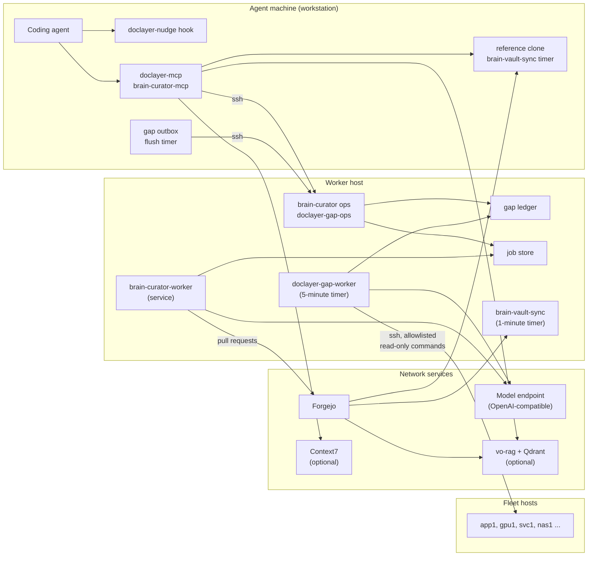

# Configuration

This page lists every setting: environment variables, curator config keys, and local evidence profiles. It ends with the deployment topology and install steps.

## Contents

- [Environment variables](#environment-variables)
- [The curator config file](#the-curator-config-file)
- [Curator config keys](#curator-config-keys)
- [The example config](#the-example-config)
- [Local evidence profiles](#local-evidence-profiles)
- [The routing policy](#the-routing-policy)
- [Deployment topology](#deployment-topology)
- [Units and timers](#units-and-timers)
- [Install](#install)

## Environment variables

When each setting is read:

- **`DOC_LAYER_*` variables** are read once, when `doclayer.settings` is imported: the module-level `settings = Settings()` copies them into attributes (`settings.py`). A running process, such as `doclayer-mcp`, sees a change only after a restart. Code that builds a fresh `Settings()` reads the environment again at that moment; tests use this, and short-lived commands such as the hook start a new process each time anyway.
- **The brain repository** is the exception: `DOC_LAYER_BRAIN_REPO` and the pointer file `~/.config/doclayer/brain-repo` are read again on every access (`Settings.brain_repo_selection`), so a long-running server follows a pointer change without a restart.
- **The curator config file** and its variables (`BRAIN_CURATOR_*`, `CURATOR_INFERENCE_*`) are read on every `curator/config.py:load_config` call. The gap worker, dispatcher, discovery, verification and private writer call it each time they need a value; `brain-curator-worker` and the `brain-curator` CLI load it once at start; `brain-curator-mcp` loads it on its first tool call and keeps it.
- **`BRAIN_CURATOR_LOCAL`** is read on each transport choice (`curator/transport.py:transport_for`).

An empty value means "not configured": the feature that needs it is off and says so.

### Resolver and sources (`settings.py`)

| Variable | Default | Purpose |
|---|---|---|
| `DOC_LAYER_BRAIN_REPO` | unset | Path of the vault clone to read. Wins over the pointer file `~/.config/doclayer/brain-repo`; with neither, `~/brain` |
| `DOC_LAYER_ROUTING_POLICY` | empty: `<vault>/doclayer/routing-policy.yaml` | Routing policy file |
| `DOC_LAYER_CATALOG_CACHE_DIR` | `~/.cache/doclayer` | Coverage catalog and ssh alias caches |
| `DOC_LAYER_NEGATIVE_CACHE` | `~/.cache/doclayer/negative-cache.json` | Negative-result cache file |
| `DOC_LAYER_VO_RAG_URL` | `http://localhost:8001` | Vector search API (vo-rag) |
| `DOC_LAYER_VO_RAG_KEY_FILE` | `~/.config/doclayer/vo-rag-api-key` | File holding the search API key; missing means no key is sent |
| `DOC_LAYER_BRAIN_COLLECTION` | `vo_rag_brain_v1` | Search collection. Any other value withholds the search with a configuration flag, because only that collection's writer is supported |
| `DOC_LAYER_BRAIN_SYNC_STATE` | `~/.local/state/vo-rag/brain_sync.json` | The indexer's state file, read to detect index lag and acknowledge publications |
| `DOC_LAYER_CONTEXT7_URL` | `https://mcp.context7.com/mcp` | Context7 MCP endpoint |
| `DOC_LAYER_ROUTE_CONFIG` | empty: no route facts | Optional routing-config JSON the resolver may cite for route questions |
| `DOC_LAYER_TIMEOUT_VO_RAG_S` | `25` | Vector search timeout, seconds |
| `DOC_LAYER_TIMEOUT_CONTEXT7_S` | `40` | Context7 timeout, seconds |
| `DOC_LAYER_TIMEOUT_LIVE_S` | `15` | Live check timeout, seconds |
| `DOC_LAYER_STALE_COPY_DAYS` | `60` | Age after which a doc copy or an observed value is flagged stale |

### Live checks (`settings.py`, `livechecks.py`)

| Variable | Default | Used by |
|---|---|---|
| `DOC_LAYER_SSH_HOST` | empty | ssh alias of the services host; needed by `vo-rag-release`, `vo-rag-api`, `litellm-container`, `token-plan-endpoint` |
| `DOC_LAYER_SEARCH_HOST_IP` | empty | Address of the search API host; `vo-rag-api` |
| `DOC_LAYER_SEARCH_RELEASE_LINK` | empty | Release symlink of the deployed search service; `vo-rag-release` |
| `DOC_LAYER_QDRANT_URL` | `http://localhost:6333` | Qdrant base URL; `vo-rag-brain-collection` |
| `DOC_LAYER_GATEWAY_CONTAINERS` | `litellm\|litellm-db` | Container names (a regex alternation); `litellm-container` |

A check whose variable is empty reports `not configured (<VARIABLE> is empty)`.

### Knowledge gaps (`settings.py`)

| Variable | Default | Purpose |
|---|---|---|
| `DOC_LAYER_GAPS_DIR` | `~/.local/state/doclayer/knowledge-gaps` | Ledger root, outbox, slots, budgets, flags |
| `DOC_LAYER_GAP_OWNER_HOST` | empty: this machine owns the ledger | ssh alias of the ledger's owning host |
| `DOC_LAYER_GAP_OWNER` | `local` if the owner host is empty or this machine, else `ssh` | How to reach the ledger |
| `DOC_LAYER_GAP_OWNER_COMMAND` | `doclayer-gap-ops` | Command run on the owner over ssh |
| `DOC_LAYER_GAP_CAPTURE` | `1` | `0` pauses capture without deleting records |
| `DOC_LAYER_GAP_MODEL_CALLS_JOB` | `50` | Model-call grant per automatic curator job |
| `DOC_LAYER_SEARXNG_URL` | empty: SearXNG discovery off | SearXNG search endpoint for public discovery |
| `DOC_LAYER_SEARXNG_CERT_DIR` | `~/.config/doclayer/searxng` | Mutual TLS files `ca.crt`, `client.crt`, `client.key` for SearXNG |
| `DOC_LAYER_LOCAL_PROFILES` | `~/.config/doclayer/local-profiles.yaml` | Local evidence profiles; a missing file leaves them dormant |
| `DOC_LAYER_PRIVATE_READ_ROOTS` | `~/git/:~/src/` | `:`-separated directories under which the private writer may run `head` |

### Doc fetcher (`settings.py`)

| Variable | Default | Purpose |
|---|---|---|
| `DOC_LAYER_FORGEJO_URL` | empty: landing off | Forgejo base URL for fetcher pull requests |
| `DOC_LAYER_FORGEJO_TOKEN_FILE` | `~/.config/doclayer/forgejo-token` | File holding the Forgejo API token (mode 600) |

### Curator (`curator/config.py`, `curator/transport.py`)

| Variable | Default | Purpose |
|---|---|---|
| `BRAIN_CURATOR_CONFIG` | `~/.config/brain-curator/config.yaml` | Curator config file |
| `BRAIN_CURATOR_CREDENTIALS_FILE` | `~/.config/brain-curator/credentials.env` | `KEY=VALUE` file with the model API key |
| `BRAIN_CURATOR_MODE` | from `pipeline.default_mode` | `single-pass` or `multi-stage` for new jobs |
| `BRAIN_CURATOR_LOCAL` | unset | `1` forces the local job store, `0` forces ssh |
| `CURATOR_INFERENCE_URL` | from `inference.url` | Model endpoint override |
| `CURATOR_INFERENCE_MODEL` | from `inference.model` | Model id override |
| `CURATOR_INFERENCE_KEY_ENV` | from `inference.api_key_env` | Name of the variable that holds the API key |
| `CURATOR_INFERENCE_API_KEY` | unset | The default name of that variable; read from the environment, else from the credentials file |

## The curator config file

The curator reads one YAML file (`curator/config.py:load_config`). A missing file means all defaults. Unknown top-level keys are ignored; unknown keys under `stages:` fail at load. These also fail at load, never at call time: an unknown pipeline mode, a `stages:` entry that names an unknown stage, `limits.parallel_jobs` or `gap_worker.max_active_jobs` that is not a whole number of at least 1, a non-integer `request_priority`, a non-HTTP `idle_metrics_url`, or an `idle_metrics_url` whose `/upstream/<model>/` segment does not match the block's model. Secrets never go in this file.

## Curator config keys

All keys and defaults come from the dataclasses in `curator/config.py`.

### `inference` (`InferenceConfig`)

| Key | Default |
|---|---|
| `url` | `http://localhost:8000/v1` |
| `model` | `Qwen/Qwen3-32B` |
| `api_key_env` | `CURATOR_INFERENCE_API_KEY` |
| `serving_context_tokens` | `262144` |
| `serving_max_output_tokens` | `8192` |
| `prompt_token_target` | `16384` |
| `output_token_target` | `4096` |
| `timeout_s` | `300.0` |
| `retries` | `2` |
| `concurrency` | `1` |
| `enable_thinking` | `false` |
| `thinking_budget_field` | `thinking_token_budget` |
| `thinking_token_budget` | `2048` |
| `chars_per_token` | `2.5` |
| `request_priority` | `null` |
| `idle_metrics_url` | `null` |
| `idle_poll_s` | `15.0` |

[models.md](models.md) explains each.

### `stages`

A map from `discovery`, `planning`, `curation`, `verification` or `extraction` to any `inference` keys. Default `{}`. See [models.md](models.md#per-stage-overrides).

### `pipeline` (`PipelineConfig`)

| Key | Default |
|---|---|
| `default_mode` | `single-pass` |

### `single_pass` (`SinglePassConfig`)

| Key | Default | Meaning |
|---|---|---|
| `max_model_calls` | `200` | Model calls per job |
| `max_active_seconds` | `14400.0` | Active time per job |
| `max_sources` | `50` | Submitted sources per job |
| `max_extract_calls` | `60` | Extraction chunks per job |
| `max_pages` | `20` | Pages per job |
| `max_calls_per_page` | `10` | Draft, JSON re-ask and grounding calls per page |
| `max_grounding_chunks` | `10` | Grounding chunks per page |

### `limits` (`LimitsConfig`)

| Key | Default | Meaning |
|---|---|---|
| `max_sources` | `50` | Sources per job, submitted plus discovered |
| `max_source_bytes` | `67108864` | Bytes per source, counted while streaming |
| `max_job_bytes` | `536870912` | Bytes per job |
| `max_active_seconds` | `7200.0` | Active time per job |
| `max_model_calls` | `200` | Model calls per job, including validation and repair |
| `fetch_concurrency` | `4` | Parallel fetches |
| `connect_timeout_s` | `10.0` | Fetch connect timeout |
| `fetch_timeout_s` | `120.0` | Fetch timeout |
| `transient_retries` | `2` | Retries for transient fetch errors |
| `max_repair_passes` | `2` | Repair passes per page or group |
| `prompt_char_budget` | `0` | Characters per prompt; `0` derives it from `inference` |
| `parallel_jobs` | `1` | Jobs the worker runs at once |

### `paths` (`PathsConfig`)

| Key | Default |
|---|---|
| `brain_checkout` | `~/.local/share/brain-curator/checkout` |
| `jobs` | `~/.local/share/brain-curator/jobs` |
| `worktrees` | `~/.local/share/brain-curator/worktrees` |
| `cache` | `~/.cache/brain-curator` |

### `publish` (`PublishConfig`)

| Key | Default | Meaning |
|---|---|---|
| `remote` | `origin` | Git remote to publish to |
| `base_branch` | `main` | Pull request base |
| `branch_prefix` | `curator/` | Prefix of publication branches |
| `allowed_prefixes` | `[wiki/, infra/]` | The only destinations a job may write |
| `denied_names` | `[index.md, log.md]` | File names never written, anywhere |
| `forgejo_url` | empty | Forgejo base URL. Every job publishes, so `brain-curator-worker` refuses to start (exit 2) while it is empty, and a job that reaches publication without it ends `failed`, not `retryable` |
| `forgejo_token_file` | `~/.config/doclayer/forgejo-token` | Token file (mode 600) |
| `force_merge` | `false` | Send Forgejo's admin `force_merge` flag when merging (opt-in, for a single-maintainer repository) |
| `author_name` | `brain-curator` | Commit author |
| `author_email` | `brain-curator@localhost.invalid` | Commit author email |

### `ssh` (`SshConfig`)

| Key | Default | Meaning |
|---|---|---|
| `host` | empty | ssh alias of the worker host. Empty means this machine is the worker |
| `remote_command` | `brain-curator ops` | Fixed remote entry point |
| `staging_subdir` | `staging` | Where transferred files go inside a job |
| `connect_timeout_s` | `15.0` | ssh connect timeout |
| `command_timeout_s` | `120.0` | Timeout for one remote call |

### `cache` (`CacheConfig`) and `retention` (`RetentionConfig`)

| Key | Default | Meaning |
|---|---|---|
| `cache.max_bytes` | `2147483648` (2 GiB) | Source cache cap |
| `cache.retention_days` | `7` | Days after a job's last activity before its cache expires |
| `retention.finished_job_days` | `90` | Days before finished jobs are deleted; corrections are kept |

### `gap_worker` (`GapWorkerConfig`)

| Key | Default | Meaning |
|---|---|---|
| `cycle_budget_s` | `null` | Research time per cycle; `null` means no limit |
| `max_active_jobs` | `1` | Gaps kept in the curator at once |

### `private_writer` (`PrivateWriterConfig`)

| Key | Default | Meaning |
|---|---|---|
| `hosts` | `[]` | ssh aliases the private writer may run commands on |
| `host_notes` | `{}` | Role note per host, shown to the planner |
| `max_commands` | `30` | Commands per plan |
| `command_timeout_s` | `60` | Timeout per command |
| `output_cap_bytes` | `131072` | Output kept per stream |
| `max_job_calls` | `200` | Model-call ceiling for a private curator job |

### Top level (`CuratorConfig`)

| Key | Default | Meaning |
|---|---|---|
| `credentials_file` | `~/.config/brain-curator/credentials.env` | The model API key file |
| `vo_rag_url` | `null` | Optional search accelerator; its outage never blocks curation |
| `user_agent` | `brain-curator/0.1 (brain wiki curator; single-user)` | HTTP user agent for fetches |

## The example config

This is `doclayer/deploy/worker/config.example.yaml` at this commit, copied verbatim. It shows a deployment on the fictional fleet, with comments on each choice. `deploy.sh` installs it as the worker's config when none exists.

```yaml
# brain-curator worker configuration — example without secrets.
#
# Copy to ~/.config/brain-curator/config.yaml on the worker host (worker1)
# and adapt. Secrets NEVER live here: the inference API key is read from
# ~/.config/brain-curator/credentials.env (chmod 600) as
# CURATOR_INFERENCE_API_KEY=<key>. The values below are an example deployment on a
# fictional fleet (ws1, app1, gpu1, svc1, worker1, nas1); the file only needs
# entries you want to change.
#
# See doclayer/src/doclayer/curator/config.py for the authoritative list of
# keys and their (public-safe) defaults.

inference:
  # The one model endpoint (OpenAI-compatible). This example uses a local
  # server on gpu1 (llama-swap -> vLLM). A hosted endpoint works the same way:
  #   url: https://api.example.com/v1
  #   thinking_budget_field: thinking_budget   # some hosts name it differently from vLLM's thinking_token_budget
  # with the hosted key as CURATOR_INFERENCE_API_KEY. There is no fallback
  # provider: if inference is down, jobs preserve progress and report retryable failure.
  url: http://gpu1:9292/v1
  model: Qwen/Qwen3-32B
  # Serving limits as currently known. These cap client requests; never
  # reconfigure the shared server to meet the client. Verify with a real
  # probe during deployment (runbook §Live validation) and adjust here.
  serving_context_tokens: 262144   # gpu1 vLLM max_model_len
  serving_max_output_tokens: 8192
  # Per-request targets (prompt includes instructions, page context, evidence).
  prompt_token_target: 16384
  output_token_target: 4096
  timeout_s: 300
  retries: 2
  concurrency: 1  # inference requests at once within ONE job; parallel_jobs multiplies it
  enable_thinking: false  # preserve response budget for structured final JSON
  # worker1 could set concurrency: 5 (parallel model requests within one job).

# Optional per-stage overrides of any inference key. An absent stage uses
# `inference` unchanged, except `extraction`, which inherits `curation` (and
# layers its own keys on top of it). Stages: discovery, planning, curation,
# verification, extraction.
# Unknown stage names or keys fail at load. Example (no stage overrides url or
# api_key_env, so all four use the endpoint above):
# stages:
#   discovery:    {model: small-model}     # many short page judgments
#   planning:     {model: large-model}     # read-only command plans
#   curation:     {model: large-model}     # extract, draft, edit, review
#   verification: {model: other-family-model}   # independent family from the writer
#
# Extraction on gpu1's local model as background work. Only the extract calls
# go to gpu1; every other stage stays on the main endpoint.
#   extraction:
#     url: http://gpu1:9292/v1
#     model: Qwen/Qwen3-32B
#     api_key_env: GPU1_API_KEY                   # in credentials.env
#     thinking_budget_field: thinking_token_budget  # vLLM's key (hosted uses thinking_budget)
#     serving_context_tokens: 262144
#     request_priority: 100        # sent as top-level `priority`; vLLM runs lower values
#                                  # first, so 100 is behind every default (0) request.
#                                  # Absent = key not sent.
#     idle_metrics_url: http://gpu1:9292/upstream/Qwen/Qwen3-32B/metrics
#                                  # The /upstream/<model>/ segment must equal this block's
#                                  # model (checked at load). llama-swap's /running (same
#                                  # host): another model loaded, or this one starting, makes
#                                  # the gate wait without touching /upstream (a poll there
#                                  # could unload another model); nothing loaded proceeds
#                                  # (the request cold-loads it). Then each
#                                  # request waits until that vLLM reports
#                                  # num_requests_waiting == 0 and no running request
#                                  # beyond this process's own in-flight ones. The metrics
#                                  # use the stage's bearer key; an unreachable endpoint
#                                  # (no connection) is waited out, an unusable answer
#                                  # lets requests through (each logged once per
#                                  # client). Waiting has no timeout, is recorded
#                                  # as usage.idle_wait_seconds and is not active time.
#     idle_poll_s: 15              # seconds between idle checks while busy

limits:
  max_sources: 50                # distinct sources per job (submitted + discovered)
  max_source_bytes: 67108864     # 64 MiB per source, enforced while streaming
  max_job_bytes: 536870912       # 512 MiB total transfer per job
  max_active_seconds: 7200       # 2 h active processing (excludes queue/restart)
  max_model_calls: 200           # includes validation and repair calls
  fetch_concurrency: 4
  parallel_jobs: 1               # jobs the worker runs at once; publication stays one at a time
                                 # (worker1: 5; a job that crashes ends retryable, "worker crash: ...")
  transient_retries: 2
  max_repair_passes: 2           # per affected page/group

paths:
  brain_checkout: ~/git/brain-curator
  jobs: ~/.local/share/brain-curator/jobs
  worktrees: ~/.local/share/brain-curator/worktrees
  cache: ~/.cache/brain-curator

publish:
  remote: origin
  base_branch: main
  branch_prefix: curator/
  # Canonical destinations a curator job may write. Librarian-owned files
  # (index.md, log.md) are always denied.
  allowed_prefixes: [wiki/, infra/]
  denied_names: [index.md, log.md]
  forgejo_url: https://git.example.org
  # Reuses the existing fetcher token file; override only if the worker gets
  # its own credential. chmod 600, never committed.
  forgejo_token_file: ~/.config/doclayer/forgejo-token
  # Opt-in: lets a single-maintainer repo land curator PRs with the admin
  # merge override, since Forgejo forbids self-approval.
  force_merge: true
  author_name: brain-curator
  author_email: brain-curator@git.example.org

ssh:
  # Used by workstation CLI/MCP clients to reach this host's ops entry point.
  host: worker1
  remote_command: ~/git/brain-curator/doclayer/.venv/bin/brain-curator ops
  connect_timeout_s: 15
  command_timeout_s: 120

cache:
  max_bytes: 2147483648   # 2 GiB global cache cap
  retention_days: 7       # expire a job's cache 7 days after its last activity

retention:
  finished_job_days: 90   # drafts/state/summaries of finished jobs; corrections and
                          # unresolved jobs are kept indefinitely

# Gap worker pacing.
gap_worker:
  cycle_budget_s: null           # null = no soft cycle budget (run until the queue is empty);
                                 # set seconds to bound a cycle. The unit's TimeoutStartSec=8h
                                 # is only a hang guard.
  max_active_jobs: 1             # gaps the dispatcher keeps in curation at once (worker1: 5)

# Automatic private pages (gap worker): allowlisted read-only evidence -> private single-pass job.
private_writer:
  hosts: [ws1, app1, gpu1, svc1, worker1, nas1]
  host_notes:
    ws1: "local workstation (Ubuntu desktop); 'the workstation' and 'locally' mean ws1"
    app1: "application host: Docker stacks and a local model endpoint"
    gpu1: "GPU inference host: serves the local model (llama-swap -> vLLM, port 9292)"
    svc1: "services host: Forgejo and other service containers"
    worker1: "worker host: brain curator and gap worker (runs commands locally)"
    nas1: "storage host"
```

## Local evidence profiles

A profiles file (`DOC_LAYER_LOCAL_PROFILES`, default `~/.config/doclayer/local-profiles.yaml`) tells the gap loop which questions are about the operator's own machines. Profiles only decide whether a question is local and route it to the private path; they collect nothing. Evidence for a local need comes only from the private writer's allowlisted commands ([knowledge-loop.md](knowledge-loop.md#6-filling-a-private-need)). Without the file, profiles are dormant and only the built-in rules in `question_scope.py` decide.

Schema (`local_profiles.py:load_profiles`, which names the bad field in a `ProfileError`):

| Key | Type | Meaning |
|---|---|---|
| `profiles` | list | Checked in order; the first match wins (`Profiles.select`) |
| `profiles[].name` | string, required, unique | Profile name |
| `profiles[].match` | list of regex, at least one | Any one must match the question (case-insensitive) |
| `profiles[].require` | list of regex | All must also match |
| `profiles[].always_local` | bool | Every matching question is a local need |
| `profiles[].stop` | bool | A matching question gets no profile, so later profiles cannot claim it |
| `local_need_terms` | one regex string | Words that make a question local when it also asks about installation, deployment or configuration |

The keys `documents`, `observations` and `sections` (in a profile) and `context` (at the top level) are not supported; the loader rejects them by name with a `ProfileError`.

The file is reloaded when its modification time or size changes. `local_material:is_local_need` and `question_scope:private_question` read it.

An illustration of the retained keys, on the fictional fleet (see `doclayer/examples/local-profiles.example.yaml` for the full example):

```yaml
local_need_terms: '\b(svc1|nas1)\b'

profiles:
  # Crash questions about the workstation only, not about any crash.
  - name: desktop-crash
    match: ['\b(logouts?|freezes?|crash(es)?|graphics drivers?)\b']
    require: ['\b(ws1|desktop|workstation|gnome)\b']

  # A matching question gets no profile, so `desktop` below cannot claim it.
  - name: unrelated-analytics
    match: ['\banalytics\b']
    stop: true

  - name: desktop
    match: ['\b(desktop|workstation|gnome)\b']

  # Every matching question is a local need.
  - name: curator
    match: ['\b(brain|curator|worker1|gap worker)\b']
    always_local: true
```

## The routing policy

`doclayer/routing-policy.yaml` (or `DOC_LAYER_ROUTING_POLICY`) adds what the router cannot derive from pages. Keys read by `coverage.py:build_catalog`:

| Key | Meaning |
|---|---|
| `version` | Bump when policy meaning changes; catalogs and negative-cache entries are bound to it |
| `subjects.<slug>` | `kind`, `aliases`, `facets`, `related`, `live_checks`, `public_docs.base_url` |
| `hosts` | Extra known hosts beyond the ssh config; known, never proof of documentation |
| `exclusions` | Page stems that never become subjects |
| `local_first` | Subjects whose questions lead with local facts even though public docs exist |
| `early_projects` | Projects too new to document: `aliases`, `path`. A question about one records no gap |

## Deployment topology



| Where | What runs | What it needs |
|---|---|---|
| Agent machine | `doclayer-mcp`, `brain-curator-mcp`, `doclayer-nudge`, the outbox flush timer, a reference clone kept by `brain-vault-sync` | ssh access to the worker host; `DOC_LAYER_GAP_OWNER_HOST` and the curator config's `ssh.host` set to it |
| Worker host | `brain-curator-worker`, `doclayer-gap-worker`, `brain-vault-sync`, the ops entry points, the ledger and job store | The curator config and credentials, a Forgejo token, push access to the vault, ssh access to fleet hosts named in `private_writer.hosts` |
| Fleet hosts | Nothing installed; they answer read-only ssh commands | An ssh account the worker can reach with BatchMode |
| Network | Forgejo, the model endpoint, optionally vo-rag and Context7 | |

## Units and timers

| File | Install on | Type | Schedule |
|---|---|---|---|
| `deploy/worker/brain-curator.service` | Worker host | Long-running, `Restart=on-failure` | Always on |
| `deploy/worker/doclayer-gap-worker.service` + `.timer` | Worker host | Oneshot | 2 min after boot, then 5 min after each run ends |
| `deploy/workstation/doclayer-gap-worker.service` + `.timer` | Agent machines | Oneshot (`doclayer-gaps flush`) | 2 min after boot, then every 5 min |
| `deploy/vault-sync/brain-vault-sync.service` + `.timer` | Worker host and agent machines | Oneshot | Every minute, up to 10 s jitter |

All are systemd user units (`systemctl --user`).

## Install

### Worker host

1. Configure ssh so the worker can reach the forge and, for the private writer, each fleet host in `private_writer.hosts`.
2. From an agent machine with a clean checkout, run `doclayer/deploy/worker/deploy.sh <worker> <checkout>`. It clones the vault to `~/git/brain-curator`, runs `uv sync --frozen`, copies `config.example.yaml` to `~/.config/brain-curator/config.yaml` if no config exists, installs `brain-curator.service`, and restarts it.
3. Edit `~/.config/brain-curator/config.yaml`: the model endpoint, `publish.forgejo_url`, `ssh.host`, `private_writer.hosts`.
4. Create `~/.config/brain-curator/credentials.env` (mode 600) with `CURATOR_INFERENCE_API_KEY=<key>`, and the Forgejo token file (mode 600).
5. Write the pointer `~/.config/doclayer/brain-repo` and the search key file if you use vo-rag, then run `doclayer/deploy/worker/deploy-gap-worker.sh <worker> <checkout>` to install the gap worker timer.
6. Run `doclayer/deploy/vault-sync/install-worker.sh <worker>` and register the consumers in `~/.config/brain-vault-sync/consumers.json`.
7. Check one real gap end to end, then `touch ~/.local/state/doclayer/knowledge-gaps/curator-ready` ([gap-worker.md](gap-worker.md#turning-dispatch-on)).

### Agent machine

1. `cd doclayer && uv sync`.
2. Run `doclayer/.venv/bin/python doclayer/deploy/vault-sync/install-workstation.py` to create the reference clone and its timer.
3. Set `DOC_LAYER_GAP_OWNER_HOST=<worker>` in the environment the MCP server and hook run in, and set `ssh.host: <worker>` in `~/.config/brain-curator/config.yaml` for the curator CLI and MCP server.
4. Register `doclayer-mcp` (and `brain-curator-mcp` if wanted) in the agent's MCP config ([README](../README.md#quickstart)) and the hook ([agent-integration.md](agent-integration.md#installing-the-hook)).
5. Install the flush timer: copy `doclayer/deploy/workstation/doclayer-gap-worker.{service,timer}` to `~/.config/systemd/user/`, then `systemctl --user daemon-reload && systemctl --user enable --now doclayer-gap-worker.timer`.
