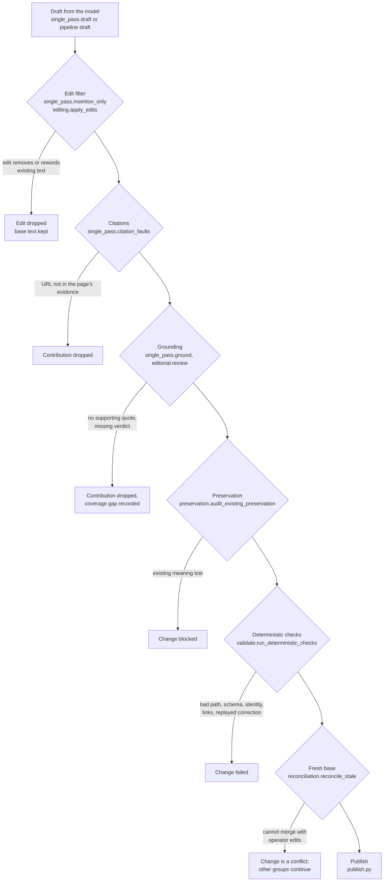

# Why unattended publishing is safe

The curator publishes wiki edits without a reviewer in the loop. That is only acceptable if a bad draft cannot reach `main`. This page lists the guarantees that stop one, the module that enforces each, and the test file that pins it. All test paths are under `doclayer/tests/curator/`.

The rule behind every guarantee: **the model proposes, deterministic code disposes.** Model output and source text are untrusted data. Instructions found in either never change a job's intent, paths or rules (`curator/curate.py`).

## Contents

- [The gauntlet](#the-gauntlet)
- [Guarantees](#guarantees)
- [What a stop means](#what-a-stop-means)
- [What review is left](#what-review-is-left)

## The gauntlet

Every exit on the right keeps the page as it was. A dropped unit records a coverage gap that names what was left out and why, and the rest of the job continues.

## Guarantees

### Claims are grounded in quoted evidence

A claim enters a page only with a quote from its source. In single-pass mode a claim is supported only if its quote appears exactly once, verbatim, in the original source (`curator/curate.py:locate_support`); no model is asked. After drafting, every new sentence goes through a grounding check that must find a supporting quote (`curator/single_pass.py:ground`); a missing or negative verdict drops that contribution. In multi-stage mode, `curator/editorial.py:review` reviews whole articles or sections against the complete selected evidence, and `curator/placement.py` tracks coverage per claim, so planning a page never counts as covering a claim.

Tests: `test_single_pass_grounding.py`, `test_single_pass_extract.py`, `test_editorial.py`, `test_placement.py`, `test_draft_claim_grounding.py`.

### Citations point only at the page's own evidence

A contribution may cite only the accepted evidence URLs of its page. `curator/single_pass.py:citation_faults` drops any contribution that carries another URL: a scheme or `//host` link, a Markdown or HTML link, a `www.` host, a `mailto:` or `data:` URI, a `host:port` address, or a bare `host.tld/path` whose last label is a real top-level domain. Code and product names such as `Vue.js/React` are not mistaken for hosts.

Tests: `test_single_pass_editing.py`.

### Existing text survives

Single-pass drafts may only insert. `curator/single_pass.py:insertion_only` drops an edit that would remove or reword existing text unless an operator correction authorizes it, and `curator/single_pass.py:base_text_faults` checks that every base sentence is still present. In multi-stage mode, `curator/editing.py:apply_edits` applies bounded edits anchored to exact locations in a page whose other bytes are kept, and `curator/preservation.py:audit_existing_preservation` compares changed material with its original context and evidence. Unknown support never authorizes deleting knowledge.

Tests: `test_single_pass_editing.py`, `test_bounded_editing.py`, `test_existing_preservation.py`, `test_editorial_preservation.py`, `test_section_restore.py`.

### Operator edits are merged, not overwritten

Publication re-reads every destination page from fresh `origin/main`. If the operator edited a page after the draft was made, `curator/reconciliation.py:reconcile_stale` merges the draft onto the new text over complete page bytes, and the result is validated again. A change that cannot be reconciled becomes a `conflict` and is not published; unrelated groups continue. A page created meanwhile at the same path goes through `reconcile_collision`.

Tests: `test_reconciliation.py`, `test_reconciliation_contract.py`, `test_single_pass_reconcile.py`, `test_publish_reconciliation_recovery.py`.

### Source conditions stay attached to facts

A fact that holds only for an edition, platform or region in the source must keep that condition on the page. `curator/source_constraints.py:verify` checks a claim against the complete governing region of its source (its section and parent headings) without keeping the whole source. `curator/policy.py` carries include and exclude rules, and any semantic restriction on a rule, from intake through extraction to publication.

Tests: `test_source_ancestor_constraints.py`, `test_source_context_selection.py`, `test_systemic_quality.py`.

### Deterministic checks gate every publication

`curator/validate.py:run_deterministic_checks` re-derives every safety property from scratch, trusting nothing the planner said:

- **Destination.** The path must start with one of `publish.allowed_prefixes` and must not be named in `publish.denied_names` (`check_path_allowed`).
- **Schema.** Required frontmatter, a valid `privacy` value, a valid `source_origin`, a `concept_id` of the form `c-` plus 8 hex digits, non-empty `tags`, an `updated` date. New pages use `privacy: internal` and a fresh `concept_id`; updates keep the page's `concept_id` and `privacy` (`check_frontmatter`).
- **Scope.** An update changes only what its intent covers; dropped sections are restored (`check_update_scope`, `restore_dropped_sections`).
- **Links.** Wikilinks resolve to existing or co-published pages (`check_links`).
- **Corrections.** A draft may not restore a corrected claim (`check_corrections_replay`).
- **Absence claims.** New text may not assert that a source does not say something; omission from the checked sources is not evidence of absence (`check_absence_claims`).

Tests: `test_validate.py`, `test_corrections.py`, `test_scope_repair.py`, `test_pipeline_scope.py`.

### Work fits its bounds or stops visibly

`curator/capacity.py` decides before any model call whether a review can hold a page's evidence, and whether a draft newly cites a source the import policy rejects. Evidence is never cut to fit: a unit that cannot fit is dropped with its sizes recorded (see the next section), and the review never runs on partial evidence.

Tests: `test_capacity_batch_review.py`, `test_pipeline_capacity.py`, `test_unit_overflow.py`.

### One rule for a unit that cannot finish

`curator/degrade.py:degrade_unit` handles a section edit, placement, review chunk or extraction chunk whose reply is still rejected after its bounded retries, or whose input does not fit: the unit keeps its original content, a current coverage gap names the unit and the cause, and the job continues. Safety validators (scope, grounding, preservation, protected material) are never degraded this way; they still block publication.

Tests: `test_unit_degrade.py`, `test_edit_budget_degradation.py`, `test_editorial_budget_degradation.py`.

### Missing evidence is never a negative fact

When a model task stops before publication (truncated output, a malformed reply after its retries), `curator/stopped_task.py:record_task_stop` records a typed stop bound to the operation and stage. For a gap job, the dispatcher then retires the job's automatic allowance with a receipt and moves the gap to `failed`, with the reason `model_response_unresolved` (`dispatcher:GapDispatcher.retire_exhausted`). The need still counts as outstanding in the digest, and the job keeps its work for an operator retry or readmission. The stop is never recorded as "the source does not support this", and the gap is never marked resolved.

Tests: `test_model_task_retirement.py`, `test_placement_truncation.py`, `test_stopped_job_release.py`.

## What a stop means

| Outcome | What happens to the page | What happens to the job |
|---|---|---|
| Edit or contribution dropped | Unchanged at that spot | Continues; coverage gap recorded |
| Change failed validation | Unchanged | Other groups may publish; job may end `partial` |
| Conflict with operator edits | Operator's version kept | Other groups may publish |
| Workload limit reached | Unchanged | `retryable`, all finished work kept |
| Model outage | Unchanged | `retryable`; resumes at its checkpoint |

## What review is left

Review is optional and happens after publication. Every publication is a pull request and a merge commit. The operator can read the digest (`brain-curator result`), the exact diff (`brain-curator inspect --what diff`) and the retained evidence (`--what evidence`), record a correction that future imports must respect, or `git revert` a merge.
