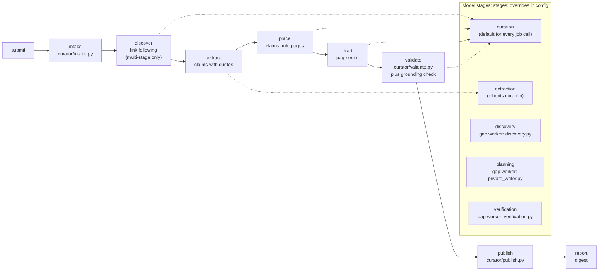
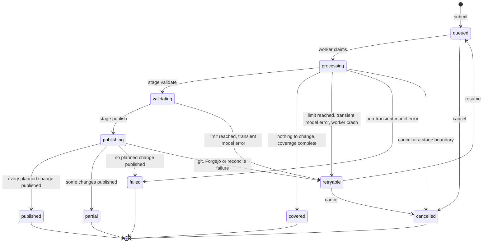

# The curator

The curator turns submitted material (URLs, pasted text, files, PDFs) into edits of wiki pages, checks them, and publishes them through pull requests without waiting for a reviewer. It runs as a durable worker on one host. Clients reach it over ssh with the `brain-curator` CLI or the `brain-curator-mcp` tools.

This page covers how a job runs and how to operate the curator. [curator-quality.md](curator-quality.md) explains why unattended publishing is safe. The knowledge-gap worker is one of its clients; see [knowledge-loop.md](knowledge-loop.md).

## Contents

- [A job from submit to publish](#a-job-from-submit-to-publish)
- [Pipeline stages and model stages](#pipeline-stages-and-model-stages)
- [Single-pass and multi-stage](#single-pass-and-multi-stage)
- [Job states](#job-states)
- [Publication](#publication)
- [Corrections](#corrections)
- [Commands](#commands)
- [Code map](#code-map)
- [Layout on the worker host](#layout-on-the-worker-host)
- [Deploy](#deploy)
- [Retention](#retention)
- [Rollback](#rollback)
- [Troubleshooting](#troubleshooting)

## A job from submit to publish

1. A client calls `submit` (CLI `brain-curator submit` or MCP `submit_import`). `curator/transport.py` copies any local files to the worker over ssh, then sends one JSON request to `brain-curator ops submit` on the worker.
2. `curator/ops.py` validates the request and writes the job to the job store (`curator/jobstore.py`) as `queued`. It returns the job id at once. The idempotency key comes from the content, so a retried identical submit returns the same job.
3. `brain-curator-worker` (`curator/worker.py`) claims queued jobs in submission order and runs up to `limits.parallel_jobs` at once, one thread each.
4. `curator/pipeline.py:Pipeline` runs the job stage by stage and persists the state after each stage, so a restart resumes at the recorded stage.
5. Validated changes are published through a pull request (`curator/publish.py`). One publication runs at a time, behind the job store's publish lock.
6. The job ends with a digest (`summary.md`) listing created and updated pages, sources, gaps, conflicts, usage and the pull request and merge commit.

## Pipeline stages and model stages

Pipeline stages are the steps a job records (`curator/state.py:STAGES`): `intake`, `discover`, `extract`, `place`, `draft`, `validate`, `publish`, `report`.

Model stages are the five places that call a model, each of which may use its own model (`curator/config.py:STAGES`): `discovery`, `planning`, `curation`, `verification`, `extraction`. Only `curation` and `extraction` are used inside a curator job; the other three are used by the gap worker.



`curator/config.py:stage_config(cfg, stage)` returns the config with that stage's `stages:` overrides applied. A stage without overrides uses `inference` unchanged. `extraction` falls back to `curation` and layers its own keys on top (`STAGE_FALLBACK`). The pipeline uses `stage_config(cfg, "curation")` for every call except extraction chunks, which use `extraction`. See [models.md](models.md).

## Single-pass and multi-stage

New jobs run **single-pass** unless told otherwise. The default comes from `pipeline.default_mode` (code default `single-pass`), which `BRAIN_CURATOR_MODE` overrides. A submit may pass `--mode multi-stage` (CLI) or `mode="multi-stage"` (MCP). Correction jobs always run multi-stage, a job's mode never changes after submit, and jobs saved before single-pass existed load as multi-stage.

| Stage | Single-pass (`curator/single_pass.py`) | Multi-stage (`curator/pipeline.py`) |
|---|---|---|
| discover | Submitted sources only, no model call | Follows links, scores relevance with the model |
| extract | Up to `single_pass.max_extract_calls` (60) chunks; a claim is supported only if its quote occurs exactly once, verbatim, in the source (`curator/curate.py:locate_support`) | Model-verified source support |
| place | The named `targets`, or one planning call | Source admission, placement plans, re-admission of older claims |
| draft | One bounded-edit call per page; edits that remove or reword existing text are dropped | Per-section routing, edit retries, repair passes |
| validate | Deterministic checks plus one grounding check of the new text | Sectioned editorial review, preservation audits, repairs |
| publish | Region merge with no model call; an overlap keeps the fresh canonical text | Model-assisted reconciliation |

Single-pass runaway guards (`single_pass:` in config, `SinglePassConfig`): `max_model_calls` 200, `max_active_seconds` 14,400 (4 h), `max_sources` 50, `max_extract_calls` 60, `max_pages` 20, `max_calls_per_page` 10 (draft, JSON re-ask and grounding chunks), `max_grounding_chunks` 10. None of them limits how many supported claims a page receives. Multi-stage jobs use `limits:` instead.

`targets` (CLI `--target`, MCP `targets=[...]`) names the pages a single-pass import should update or create. They are accepted for single-pass jobs only and validated like any destination.

Single-pass exists because the multi-stage pipeline took hours per import. See [design-decisions.md](design-decisions.md#single-pass-curation).

## Job states

From `curator/state.py:JOB_STATUSES`. The first four are in flight.



- `covered` is a successful no-op: the material is already in the wiki. It does not mean every source was reviewed.
- `partial` publishes only coherent groups of changes that passed; the rest are reported.
- `retryable` keeps every finished stage. `resume` continues it at the recorded stage.
- There is no "awaiting review" state. Publication is automatic after validation.

Each page change has its own status (`CHANGE_STATUSES`): `pending`, `drafted`, `validated`, `failed`, `conflict`, `published`, `skipped`.

## Publication

`curator/publish.py` publishes one attempt like this:

1. Take the global publication lock.
2. Fetch `origin` and cut a fresh worktree from `origin/main`. Never use the operator's checkout.
3. Re-read every destination page. If the operator changed a page since the draft, reconcile the draft with the new text (`curator/reconciliation.py`) and check it again. A change that cannot be reconciled becomes a `conflict`, and the other groups continue.
4. Write only validated destinations, stage them explicitly, and commit as `publish.author_name` / `publish.author_email`.
5. Push the branch (prefix `publish.branch_prefix`, default `curator/`), open a pull request against `publish.base_branch`, and merge it.

Every step records the publication identity (branch, push, commit, pull request, merge) in the job state. An uncertain network reply is answered by asking Forgejo what happened, never by repeating a write. A merge counts only when the pull request reports merged with a merge commit.

**Merging.** `curator/forgejo.py:CuratorForgejo.merge_pr` checks the pull request's head commit and base branch, waits for any required status checks, and then merges. Forgejo does not let a user approve their own pull request, so a repository with one maintainer cannot satisfy a required approval. `publish.force_merge: true` (default `false`) sends Forgejo's admin `force_merge` flag with the merge request. Turn it on only for a repository where the curator's account is meant to land changes without a second approver.

**Scope.** The curator writes only under `publish.allowed_prefixes` (default `wiki/`, `infra/`) and never files named in `publish.denied_names` (default `index.md`, `log.md`) (`curator/validate.py:check_path_allowed`). It does not delete or rename pages.

## Corrections

`brain-curator correct --page wiki/x.md --claim "the wrong claim" --instruction "..."` (MCP `job_correct`) records a correction in `<jobs>/corrections.jsonl` and queues a correction job that edits the page. The correction is permanent and survives job cleanup. Any later import whose draft would restore the corrected claim fails `curator/validate.py:check_corrections_replay` and is repaired or dropped. A correction recorded while a job is in flight is checked again at publish time with no model call.

Edits the operator makes directly in the vault are kept by the stale-base reconciliation in step 3 above.

## Commands

The CLI and the MCP tools offer the same operations. Every command prints one JSON document.

```bash
brain-curator submit --intent "Example CLI configuration" --url https://example.com/docs/config \
                     [--url ...] [--file notes.md] [--text-file findings.md] [--directory dir/] \
                     [--manifest batch.yaml] [--exclude "billing pages"] [--mode single-pass|multi-stage] \
                     [--target wiki/example-app-deployment.md] [--limit max_sources=20] [--idempotency-key KEY]
brain-curator status   --job job-xxxx
brain-curator result   --job job-xxxx [--no-digest]
brain-curator inspect  --job job-xxxx --what diff|draft|evidence [--path wiki/page.md]
brain-curator resume   --job job-xxxx [--extend max_model_calls=50] [--operator-readmission]
brain-curator continue --job job-xxxx [--source SRC] [--refresh-source SRC] [--url URL] \
                       [--no-discover] [--no-review-omitted] [--intent TEXT] [--mode M] [--target PATH] \
                       [--policy-manifest policy.yaml]
brain-curator cancel   --job job-xxxx
brain-curator correct  --page wiki/page.md --claim "the wrong claim" --instruction "what to do"
brain-curator list
brain-curator ops OPERATION < request.json     # the raw entry point the ssh transport uses
```

Global options: `--local` uses the local job store instead of ssh; `--config PATH` picks a config file. Without `--local`, the transport is local when `ssh.host` is empty or names this machine, and ssh otherwise. `BRAIN_CURATOR_LOCAL=1` forces local and `BRAIN_CURATOR_LOCAL=0` forces ssh (`curator/transport.py:transport_for`).

- **`resume`** continues the same stopped job from its checkpoint, keeping its counters. `--extend` raises a limit explicitly. A job whose automatic allowance was retired by the gap worker needs `--operator-readmission` with a positive `max_model_calls` extension.
- **`continue`** creates a new linked job that reuses the parent's evidence and cache. It never republishes the parent. Use it to review omitted sections (`--source`), add primary URLs (`--url`, which needs discovery), or refetch a source (`--refresh-source`). `--no-discover` keeps the remaining link frontier without fetching it.
- **`cancel`** takes effect at the next stage or source boundary.
- **`brain-curator-worker`** takes `--config`, `--once` (process at most one job, then exit) and `--poll-interval` (default 10 seconds).

`status` shows the mode and, for single-pass jobs, model calls per page. The digest's usage section lists calls by stage.

## Code map

Where each part of a job lives in `doclayer/src/doclayer/curator/`:

- **Entry and transport.** `cli.py` (the `brain-curator` commands), `mcp_server.py` (the same operations as MCP tools), `transport.py` (ssh or local), `ops.py` (the operations dispatcher on the worker), `worker.py` (the job loop).
- **State.** `config.py` (every key), `state.py` (job, source and change records and their statuses), `jobstore.py` (the files on disk).
- **Intake and sources.** `intake.py` turns URLs, text, files, PDFs, manifests and directories into sources, with byte caps, redirect checks and junk detection; PDFs get a page map so a claim can cite "page N". `policy.py` holds the include and exclude rules. `source_admission.py` lets a multi-stage job keep advancing its source review in bounded steps while leaving room for ordinary publication work; it never resets a budget or opens a second model route, and a source whose decision is unknown stays unresolved. `coverage.py` tracks which source sections were reviewed now, separately from older diagnostics.
- **Model work.** `model.py` is the client ([models.md](models.md)). `curate.py` holds the model tasks and their JSON contracts: relevance, extraction, placement, synthesis, checks and repair.
- **Placing and editing.** `placement.py` places each supported claim on a page and records per-claim coverage. `plan_readmission.py` handles jobs saved by older versions: when a saved plan names claim identities that are no longer in the retained evidence, it re-plans only those, per group, from source-backed evidence, without guessing and without touching other groups or the job's publication identity. `editing.py` applies bounded, anchored edits; `editorial.py` reviews articles and sections; `preservation.py` protects existing meaning; `single_pass.py` is the single-pass path.
- **Checks and stops.** `capacity.py`, `source_constraints.py`, `validate.py`, `degrade.py` and `stopped_task.py` ([curator-quality.md](curator-quality.md)).
- **Publishing.** `reconciliation.py` merges with operator edits, `publish.py` runs the publication sequence, `forgejo.py` calls the Forgejo API, and `gittools.py` wraps the Git commands publication needs (revisions, blobs, worktrees, commits), always as argument arrays with no shell.

## Layout on the worker host

| Purpose | Default path |
|---|---|
| Curator's clone of the vault | `paths.brain_checkout` (`~/.local/share/brain-curator/checkout`) |
| Job state, drafts, evidence, digests | `paths.jobs` (`~/.local/share/brain-curator/jobs`) |
| Publication worktrees | `paths.worktrees` (`~/.local/share/brain-curator/worktrees`) |
| Downloaded and extracted sources | `paths.cache` (`~/.cache/brain-curator`) |
| Config | `~/.config/brain-curator/config.yaml` |
| Model API key | `~/.config/brain-curator/credentials.env` (mode 600) |
| systemd user unit | `~/.config/systemd/user/brain-curator.service` |

The example config in `doclayer/deploy/worker/config.example.yaml` sets `paths.brain_checkout: ~/git/brain-curator`, the checkout the deploy script creates.

## Deploy

From an agent machine, with a clean, committed checkout:

```bash
doclayer/deploy/worker/deploy.sh worker1 /path/to/clean/checkout
```

`deploy.sh` refuses a dirty source or worker checkout, pushes the revision (or sends a Git bundle if the push fails), checks out that exact revision on the worker, runs `uv sync`, installs `brain-curator.service`, and restarts it. It never overwrites an existing `config.yaml` and never touches `credentials.env`. It is safe to re-run.

Create the credentials file once, by hand:

```bash
ssh worker1 'test -e ~/.config/brain-curator/credentials.env || install -m 600 /dev/null ~/.config/brain-curator/credentials.env'
# then add the line CURATOR_INFERENCE_API_KEY=<key> through a channel that does not log it
```

Also create the Forgejo token file named by `publish.forgejo_token_file` (mode 600), and make sure the worker's clone can push.

The unit (`brain-curator.service`) runs `brain-curator-worker --poll-interval 10` with `Restart=on-failure`, `TimeoutStopSec=120`, `NoNewPrivileges=yes` and `PrivateTmp=yes`. On `SIGTERM` the worker stops claiming jobs and waits for running ones; a job cut off at the timeout resumes at its last checkpoint when the unit starts again.

## Retention

- The source cache expires 7 days after a job's last activity (`cache.retention_days`) and is capped at 2 GiB (`cache.max_bytes`); the oldest inactive entries go first. Evidence and job state live outside the cache.
- Finished and cancelled jobs are deleted after 90 days (`retention.finished_job_days`). Unfinished jobs, corrections and the idempotency index are kept.
- A publication worktree is removed after its merge is verified. A later attempt removes worktrees left by a crash.

## Rollback

- Stop the worker: `systemctl --user disable --now brain-curator`. Jobs stay on disk.
- Revert published knowledge with `git revert` of the merge commit named in the job's digest (`brain-curator result --job ...`). Revert that one commit, not a batch, so later unrelated edits survive.
- Go back to an older code revision by running `deploy.sh` from an older checkout. The job store survives deploys.

## Troubleshooting

| Symptom | Check |
|---|---|
| Jobs stay `queued` | Is the unit active? `journalctl --user -u brain-curator`. Does another worker hold `index/locks/.worker.lock`? |
| `retryable` with an `inference:` error | Is the credentials file present, the endpoint reachable from the worker, the model loaded? |
| `retryable` with a `publication:` error | Can the worker's clone fetch and push? Is the Forgejo token valid? Did branch protection change? |
| `retryable` with `worker crash: ...` | The job's thread raised. `resume` continues it; the traceback is in the journal |
| `transport:` error on submit | Does `ssh <ssh.host>` work from this machine? Does `ssh.remote_command` exist on the worker? |
| Merge refused by Forgejo | A required approval cannot be given by the same account. Either add a reviewer or set `publish.force_merge: true` |
| Pages merged but answers are stale | The search indexer has not caught up, or a consumer clone is behind. Check the indexer state and `brain-vault-sync --status` (see [vault-sync.md](vault-sync.md)) |
| A resumed job spends many calls on its first repair | Drafts from older editor versions carry no handled-claim binding, so the first repair reviews the whole page again. Size `--extend max_model_calls=...` for that |
