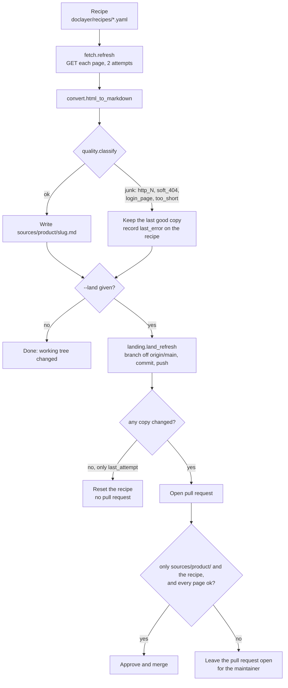

# The doc fetcher

The doc fetcher keeps Markdown copies of vendor documentation under `sources/<product>/`. The resolver reads them as dated evidence, and the coverage catalog counts them as coverage for that product.

Copies exist only where Context7 is thin. Context7 stays the default source for public documentation. A copy is worth keeping when Context7 lacks the facts a question needs, such as which models an account plan includes, its quotas, or its base URL. The resolver checks a Context7 result against the facts in the copies and withholds it when it states none of them (see [resolver.md](resolver.md#source-planning)).

## Contents

- [Flow](#flow)
- [Recipes](#recipes)
- [Fetching and converting](#fetching-and-converting)
- [Junk detection](#junk-detection)
- [Copy format](#copy-format)
- [Landing as a pull request](#landing-as-a-pull-request)
- [Staleness](#staleness)
- [Running it](#running-it)

## Flow



## Recipes

A recipe is a YAML file in `doclayer/recipes/`. The fetcher requires the keys `product` and `pages` (`fetch:load_recipe`).

```yaml
product: alibaba-model-studio          # folder name under sources/
title: Alibaba Cloud Model Studio
docs:
  site: Alibaba Cloud Documentation Center
  base_url: https://www.alibabacloud.com/help/en/model-studio/
  version: current                     # written into every copy's frontmatter
fetch_interval_hours: 168
pages:
- slug: models                         # file name: sources/<product>/<slug>.md
  url: https://www.alibabacloud.com/help/en/model-studio/models
last_attempt: '2026-10-05T04:02:02Z'   # written by the fetcher
last_error: null                       # written by the fetcher: why the last run failed, or null
```

This is an excerpt of `doclayer/recipes/alibaba-model-studio.yaml`, the one recipe in the repository. A recipe must live at `<vault>/doclayer/recipes/<name>.yaml`, because the fetcher finds the vault root from that path (`fetch:repo_root_for`). `fetch_interval_hours` is read by whatever schedules the fetcher; the fetcher itself fetches every page each run.

## Fetching and converting

`fetch:refresh` fetches each page with `httpx`, following redirects, with a 30-second timeout and two attempts per page (`DEFAULT_TIMEOUT_S`, `ATTEMPTS_PER_PAGE`). `convert:html_to_markdown` finds the article's main content node (a known content container, else `article`, `main` or `body`), drops scripts, styles and navigation, and converts the rest with `markdownify`. `convert:page_title` supplies the title.

## Junk detection

`quality:classify(status_code, html, markdown)` returns `(True, "ok")` or `(False, "junk:<why>")`:

| Verdict | Rule |
|---|---|
| `junk:http_<code>` | Status other than 200 |
| `junk:soft_404` | The HTML carries a known not-found marker, though the status is 200 |
| `junk:login_page` | The page title contains "sign in", "log in", "login" or "sign-in" |
| `junk:too_short` | The converted Markdown has fewer than 300 characters (`MIN_BODY_CHARS`) |

A junk page is never written. The previous good copy stays, and the recipe's `last_error` names every failed page so answers can say the copy may be stale.

## Copy format

Each copy carries the vault's standard frontmatter plus four fields (`fetch:_copy_page`):

```yaml
---
schema_version: 1
privacy: internal
source_origin: external
source_lineage:
  - url:https://example.com/docs/page
tags: [doclayer, source, example-cli]
updated: 2026-10-12
title: page-slug
url: https://example.com/docs/page
fetched_at: 2026-10-12T04:02:02Z
product: example-cli
version: current
---
```

Only the latest copy is on disk. Git history holds every earlier copy.

## Landing as a pull request

With `--land`, `landing:land_refresh` publishes the refresh:

1. With `DOC_LAYER_FORGEJO_URL` empty, it does nothing and reports `not-configured`.
2. It fetches `origin/main` and creates a branch `doclayer-fetch/<product>-<timestamp>` from it, carrying the uncommitted refresh along.
3. If no copy changed and the recipe change is only `last_attempt` churn, it resets the recipe and stops (`no-changes`).
4. Otherwise it commits `sources/<product>/` and the recipe, pushes, and opens a pull request.
5. It approves and merges the pull request itself only when every changed path is under `sources/<product>/` or is the recipe, and every page in the run was `ok`. Otherwise it leaves the pull request open and lists the reasons in its body (`pr-left-open`).

The token is read from `DOC_LAYER_FORGEJO_TOKEN_FILE` (default `~/.config/doclayer/forgejo-token`, mode 600). The fetcher's self-merge applies to doc copies only; every other change waits for review.

## Staleness

The resolver flags a copy whose `fetched_at` is older than `DOC_LAYER_STALE_COPY_DAYS` (default 60) days (`resolver:doc_copy_facts`), and a recipe with a `last_error` makes the answer say the copy may be out of date.

## Running it

```bash
cd doclayer
uv run doclayer-fetch recipes/alibaba-model-studio.yaml          # refresh into sources/<product>/
uv run doclayer-fetch recipes/alibaba-model-studio.yaml OUT_DIR  # write copies somewhere else
uv run doclayer-fetch recipes/alibaba-model-studio.yaml --land   # refresh, then open a pull request
```

The command prints one line per page and `N/M pages stored`, and exits 1 if any page was junk. With no recipe argument it uses `recipes/alibaba-model-studio.yaml`.

To add a product, see [development.md](development.md#adding-a-fetch-recipe).
