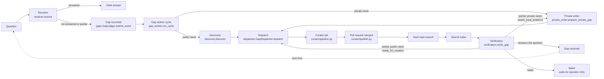
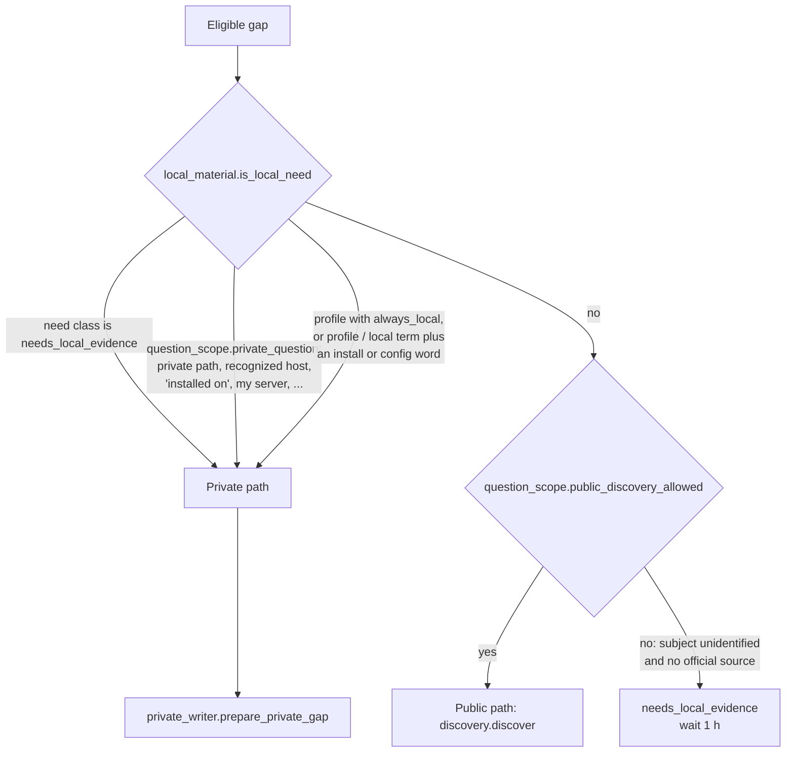
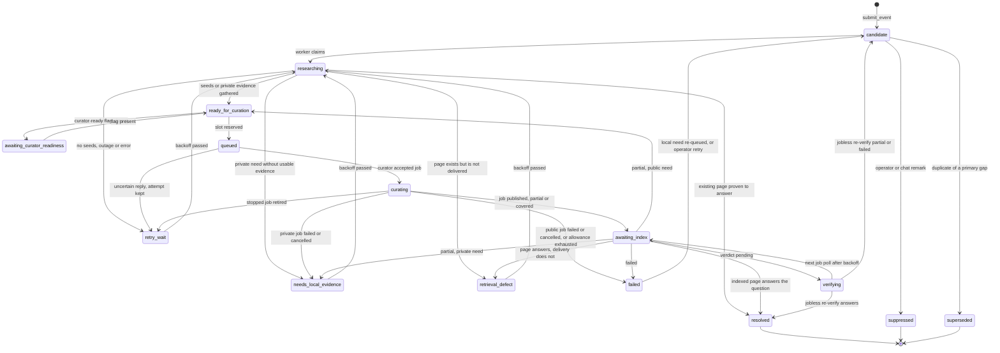
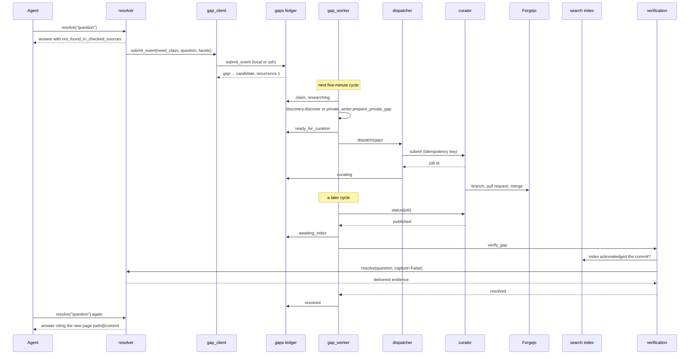

# How the brain improves itself

Every question the brain cannot fully answer becomes a knowledge gap. A background worker researches the gap, fills it with a cited page, publishes the page through a pull request, and then proves that the page answers the original question. Only then is the gap closed. The next time the question is asked, the resolver answers it from the new page, with a source and a date.

This page traces that loop through the code. Each step names the function that does it, as `module:function`. The operator commands for running the worker are in [gap-worker.md](gap-worker.md).

## Contents

- [The loop at a glance](#the-loop-at-a-glance)
- [1. Detection](#1-detection)
- [2. Capture](#2-capture)
- [3. Classification](#3-classification)
- [4. Scheduling](#4-scheduling)
- [5. Filling a public need](#5-filling-a-public-need)
- [6. Filling a private need](#6-filling-a-private-need)
- [7. Closing the loop](#7-closing-the-loop)
- [8. Safety rails](#8-safety-rails)
- [Gap states](#gap-states)
- [One gap, start to finish](#one-gap-start-to-finish)
- [Worked example on the demo vault](#worked-example-on-the-demo-vault)

## The loop at a glance



## 1. Detection

A gap starts in one of three places.

**The resolver.** After answering, `resolver:_dispositions` labels the outcome (`answered`, `partial`, `not_found_in_checked_sources`, `source_unavailable`, `index_lag`, `evidence_withheld`, `retrieval_suspected`). Anything other than a plain `answered` is a candidate. `resolver:_maybe_capture_gap` skips plain code tasks (`routing:has_code_task`) and questions with no documentation need (`routing:has_docs_need`, `routing:is_question`). See [resolver.md](resolver.md#dispositions).

**The prompt hook.** When a prompt clearly asks for documentation about a subject the catalog does not cover, `routing:classify` sets `uncovered_subject` and `gap_capture_eligible`. `nudge:_record_uncovered_candidate` records a lightweight candidate before the agent even calls a tool.

**An agent.** The MCP tool `record_gap` records a need the agent met mid-task, and `attach_source` records documentation it already found (see [mcp-tools.md](mcp-tools.md)).

A miss is a fact about the lookup, not about the subject. The negative cache (`negative_cache:NegativeCache.record`) remembers the miss for six hours so the same lookup is not repeated, but it never says "this product has no docs". See [resolver.md](resolver.md#the-negative-cache).

**Unknown subjects.** When the question names no subject in the catalog, the gap's identity is `unknown:<name>`, or `unknown:unidentified` when no name could be extracted (`gaps:normalize_subject_identity`, `gaps:canonical_identity`). The prefix stays until research links the gap to a real catalog subject (`gap_worker:_research_one` binds it only on a single exact match).

## 2. Capture

Capture must never slow down or break answering.

- `gap_client:GapClient.submit_event` writes the event to a local outbox first (`<ledger>/outbox/`, capped at 8 MiB by `OUTBOX_LIMIT`). The hook passes `defer=True`, so it only writes the file and returns. The MCP tools and the resolver try to deliver at once and keep the outbox file if delivery fails.
- `gap_client:GapClient.flush` delivers waiting events. On a workstation, a five-minute timer runs `doclayer-gaps flush`. A full outbox writes a visible `capture-degraded` marker instead of dropping events.
- `gap_client:GapClient.operation` reaches the ledger. When `DOC_LAYER_GAP_OWNER` is `local` (the default when `DOC_LAYER_GAP_OWNER_HOST` is empty or names this machine), it calls `gap_ops:handle` directly. Otherwise it runs `ssh <owner host> doclayer-gap-ops` with BatchMode, a 5-second connect timeout and one JSON request of at most 16,384 bytes on stdin.
- `gap_ops:handle("submit_event", ...)` calls `gaps:GapLedger.submit_event` on the owning host.
- `settings.gap_capture_enabled` (`DOC_LAYER_GAP_CAPTURE`, default `1`) pauses capture without deleting anything.

**Identity and deduplication.** `gaps:gap_id_for` hashes the subject identity, need class, facets, applicability and normalized question into a stable `gap-<20 hex>` id. Asking the same question again lands on the same record and increments `recurrence`. Each event carries an `event_key`; `gaps:GapLedger._seen_event` makes a replayed event a no-op, so a lost reply that is retried never counts twice. `tests/test_public_gap_identity.py` pins the identity rules. Paraphrases get their own records; `gaps:GapLedger.reconcile_duplicates` later groups equivalent records that have never been submitted, keeping the others as `superseded` and linked to the primary.

**One owner.** There is exactly one ledger, on one host. `gap_migration:retire_and_export` moves it to a new host offline, without merging two ledgers or resetting counters.

## 3. Classification

Each record has a need class (`gaps.NEED_CLASSES`):

| Need class | Meaning |
|---|---|
| `missing_coverage` | The brain has no page that answers this |
| `enrichment` | A page exists, and an agent attached a better source |
| `retrieval_defect` | A page answers it, but the resolver did not deliver it |
| `infrastructure` | A source was down or the index lagged |
| `needs_local_evidence` | Only the operator's own machines can answer it |
| `ambiguous` | The subject could not be identified |

The class decides eligibility (`gap_worker:_research_eligible`): an `ambiguous` need is never researched, because no subject was identified; an `infrastructure` need is researched only if it asks for documented facts (`question_scope:infrastructure_documentation_need`), because an outage is not missing documentation. A captured chat remark such as "can you fix this" is suppressed once by `gap_worker:_suppress_chat_remarks` (`gaps:is_chat_remark`).

Then the worker decides between the public and private paths:



`local_material:is_local_need` returns true when the need class is `needs_local_evidence`, when `question_scope:private_question` says the question is about a private installation, or when one of the operator's local evidence profiles marks it local. A profile (`local_profiles:load_profiles`) is a regex match over the question; `always_local: true` makes every match local, and `local_need_terms` adds words that make a question local when it also asks about installation, deployment or configuration. See [configuration.md](configuration.md#local-evidence-profiles).

A public product name does not make a local question public. "How is Postgres configured on app1?" is private even though Postgres has public docs.

## 4. Scheduling

The worker runs one cycle every five minutes (`doclayer-gap-worker --once` under a systemd timer; `gap_worker.DEFAULT_INTERVAL_S = 300` for `--loop`). `gap_worker:run_cycle` holds the ledger's `worker-cycle` lock, so two cycles never overlap. `gap_worker:_run_cycle` does this, in order:

1. Merge equivalent duplicates (`gaps:GapLedger.reconcile_duplicates`).
2. Re-verify grouped needs and gaps without a job that wait in `verifying`, `retrieval_defect` or `needs_local_evidence` (`gap_worker:_reverify_jobless`). The first verification that calls the model ends this step, which bounds model use per cycle.
3. Recover expired research leases back to `candidate`, and move `awaiting_curator_readiness` gaps to `ready_for_curation` once the curator is marked ready.
4. Poll curator jobs and verify finished publications (`gap_worker:_verify_published`).
5. Dispatch ready gaps to free slots (`gap_worker:_dispatch_ready`).
6. Research every eligible need (`gap_worker:_research_one`). A need that research makes ready is dispatched at once if a slot is free.
7. Prune verbose detail from resolved records older than 30 days (`gaps:GapLedger.prune_resolved_detail`) and print a digest (`gap_worker:digest`).

**Parallelism.** `gap_worker.max_active_jobs` (default 1) is how many gaps the dispatcher keeps in the curator at once (`dispatcher:GapDispatcher.max_active_jobs`). Each active submission is one file under `<ledger>/active-submissions/`. The curator itself runs `limits.parallel_jobs` jobs at once and publishes one at a time.

**Fairness.** Research order is `gap_worker:_research_order`: never-claimed needs first, then least recently claimed, with higher recurrence breaking ties. A claim is a lease with a 600-second TTL (`gaps:GapLedger.claim`), so a crashed worker's claim expires. By default a cycle has no time budget and works until no eligible need remains (`gap_worker.DEFAULT_CYCLE_BUDGET_S = math.inf`); `gap_worker.cycle_budget_s` bounds it. Research is skipped only when every slot is busy and ready work is already waiting.

**Dispatch priority.** `gap_worker:_dispatch_ready` offers submissions that are recovering from an uncertain reply first, then staged ones, then the rest by recurrence. Within one gap, seed URLs keep the order in which an agent attached them, followed by the other official sources sorted by URL (`dispatcher.SEED_PRIORITY_POLICY = "explicit-attachment-order-v1"`).

**Supersede.** An operator can mark a duplicate with `doclayer-gaps supersede <gap> --by <primary>` (`gap_ops:handle("supersede")`). A superseded or suppressed gap never reopens through verification (`gaps.CLOSED_STATES`).

**Retry backoff.** No gap is ever failed only for having tried. The waits come from these constants:

| What failed | Wait | Source |
|---|---|---|
| Public research found no seeds | 5 min, 30 min, 2 h, then once a day | `gaps:GapLedger.backoff_state` (`BACKOFF_STEPS_S = (300, 1800, 7200)`, `BACKOFF_CAP_S = 86400`) |
| Discovery could not reach the model | 5 min, not counted as an attempt | `gap_worker.OUTAGE_BACKOFF_S = 300` |
| Private evidence was empty or unusable | 1 h, 6 h, 24 h, then once a day | `private_writer:private_retry_backoff_s` (`PRIVATE_RETRY_BACKOFF_S`) |
| Private planner or hosts unreachable | 1 h | `private_writer:prepare_private_gap` |
| A verification was inconclusive | 5 min, doubling, capped at 6 h | `gap_worker:_reverify_backoff_s` |
| Existing answer pending proof | 5 min, doubling, capped at 6 h | `gap_worker:_proof_pending_backoff_s` |
| A confirmed delivery defect | 1 h | `gap_worker:_research_one` |

`tests/test_gaps.py` asserts the research ladder: `backoff_state(1) == 300`, `(2) == 1800`, `(3) == 7200`, `(4) == 86400`.

**No daily caps.** `settings.gap_jobs_per_day` and `settings.gap_model_calls_day` are fixed to `None`, and `dispatcher.JOBS_PER_DAY` and `MAX_MODEL_CALLS_PER_DAY` are `None`. Each job still has its own model-call grant (`DOC_LAYER_GAP_MODEL_CALLS_JOB`, default 50). `tests/test_gap_no_daily_quotas.py` pins this.

**Dry run until ready.** `dispatcher:GapDispatcher.curator_ready` checks for the file `<ledger>/curator-ready`. Without it, `dispatcher:GapDispatcher._dispatch` stages the exact payload in the spool and moves the gap to `awaiting_curator_readiness`, and no job is sent. No installer creates the file; the operator does, after a manual end-to-end check. `doclayer-gaps dispatch-pause` writes `<ledger>/dispatch-paused`, which stops new submissions while capture, answering and running jobs continue.

## 5. Filling a public need

1. `gap_worker:_research_one` claims the gap and moves it to `researching`. If the catalog already has pages or doc copies for the subject, or the need is a `retrieval_defect`, it first checks whether an existing page answers it (`verification:verify_existing_gap`). If one does, the gap resolves with no import.
2. `discovery:discover` looks for official documentation. It starts from the subject's `public_docs.base_url` in the routing policy and from sources an agent attached. With `DOC_LAYER_SEARXNG_URL` set, it also asks a SearXNG instance over mutual TLS. Every candidate is fetched (at most 4 MiB, every redirect checked) and judged for relevance and authority by the model (`discovery:_qwen_judgment`, the `discovery` model stage). Limits: `MAX_DISCOVERY_REQUESTS = 40`, `MAX_SEEDS = 15`, `MAX_SEMANTIC_CALLS = 20`.
3. With seeds, the gap moves to `ready_for_curation`. Without any, it goes to `retry_wait` on the research backoff.
4. `dispatcher:GapDispatcher.build_payload` writes the curator request: an intent naming the question, facets, applicability and gap id; the seed URLs; exclusions for login, signup, cart, checkout and cookie pages; `submitted_by: doclayer-gap-dispatcher`; a model-call limit; and an idempotency key from `dispatcher:attempt_key`, which hashes the gap id, attempt number and ordered seeds. A retried submit returns the same job.
5. `gap_budget:ResourceBudget.reserve_attempt` records the grant before the request is sent. The slot file is written, the gap moves to `queued`, and `curator/transport.py` sends `submit` to the worker host. On a reply the gap moves to `curating` and stores the job link. On an uncertain reply it moves to `retry_wait` holding the exact same attempt; see [reliability.md](reliability.md).
6. The curator runs the job (single-pass by default): intake, extraction of claims with verbatim quotes, placement onto pages, one insert-only draft per page, deterministic checks plus one grounding check, then publication as a pull request that merges into `wiki/` or `infra/`. See [curator.md](curator.md).

## 6. Filling a private need

Questions about the operator's own machines cannot be answered from the web. `private_writer:prepare_private_gap` gathers evidence instead. When `private_writer.hosts` is empty (the default), it stops before planning: it makes no model call, counts no attempt, records a `private_evidence` event with status `not-configured`, and the worker parks the gap for direct authoring. Otherwise:

1. `private_writer:_plan` asks the curator's model (the `planning` stage) for up to `private_writer.max_commands` (default 30) read-only commands. The prompt lists the allowed command forms, the allowed hosts and their role notes (`private_writer.hosts`, `private_writer.host_notes`), and the plans it made earlier for this gap with their refusals, so it never repeats one. A plan identical to an earlier plan is rejected.
2. `private_commands:refusal` checks each command before it runs: the host must be in `private_writer.hosts`, the argv must match one of the allowed forms, no argument may contain a shell metacharacter, and no argument may name a secret-bearing path. A refused command is recorded with its reason.
3. `private_commands:run_command` runs each allowed command with `ssh -o BatchMode=yes -o ConnectTimeout=5`, or `sh -c` on the worker host itself, with a timeout (`private_writer.command_timeout_s`, default 60 s) and an output cap (`private_writer.output_cap_bytes`, default 131,072 bytes).
4. `private_commands:possible_secret` scans stdout and stderr. Output that looks like a secret (a PEM key, a `password=` style assignment, credentials in a URL, a long high-entropy token) is withheld whole and never redacted.
5. Each surviving output becomes a text source labelled `live check <host> <command> #<n> @<time>`, stored on the gap with its SHA-256 hash. The gap moves to `ready_for_curation`.
6. `dispatcher:GapDispatcher.build_payload` sends these texts as a `private: true`, single-pass job with `submitted_by: gap-worker-private`, no URLs, a source policy that excludes every domain, and the subject's current pages as targets. `curator/ops.py` accepts a private job only from that submitter, only in single-pass mode, and only with text evidence. The model-call grant is the smaller of `DOC_LAYER_GAP_MODEL_CALLS_JOB` and `private_writer.max_job_calls`.

If the writer cannot finish (the planner is down, the hosts are unreachable, or nothing usable came back), the gap waits in `needs_local_evidence` with a reason. An operator can also write the page by hand from read-only evidence in a reviewed pull request and close the gap with `doclayer-gaps verify <gap> --existing`.

The full allowlist and the secret rules are in [security-model.md](security-model.md).

## 7. Closing the loop

Publication is not resolution. A merged page closes a gap only after it is indexed and proven to answer the question.

1. `gap_worker:_verify_published` polls the job. When the job ends `published`, `partial` or `covered`, the gap moves to `awaiting_index` and `verification:verify_gap` runs.
2. `verification:_index_acknowledged` waits until the search index has caught up: the index's last commit must include the publication commit, and every landed page must be indexed with its current content hash and writer version. Until then the outcome is `awaiting_index` or `verifying`.
3. The canonical check: the `verification` model stage reads the landed pages and must return, for every requested facet, a literal quote from the page that answers it with its qualifications (`verification:_semantic_evidence`, `verification:_validate_semantic`). Invented or non-contiguous quotes are rejected.
4. The delivery check: the resolver is asked the original question again with `capture=False`, and the same judgment runs on the evidence it actually delivered (`verification:_delivered_pages`). If the page answers but the resolver does not deliver it, the outcome is `retrieval_defect`, which needs a delivery repair, not another import.
5. Only when both checks pass is the outcome `resolved`. `verification:verify_gap` then moves the gap itself:

   | Outcome | Gap moves to |
   |---|---|
   | `resolved` | `resolved` |
   | `partial`, public need | `ready_for_curation`: the dispatcher sends it to the curator again for what is still missing |
   | `partial`, private need | `needs_local_evidence` (direct authoring from local evidence) |
   | `failed` | `failed`, where it waits for an operator `doclayer-gaps retry` |
   | `retrieval_defect` | `retrieval_defect` (also set by `gap_worker:_verify_published`, with a one-hour backoff) |
   | verdict not available yet | `verifying`, re-checked on the 5-minute-doubling backoff |

   Two paths send a `partial` or `failed` gap back to `candidate` for research instead, through `gap_worker:_requeue_uncovered`: a local need whose published page did not answer it (`gap_worker:_verify_published`; a private `partial` keeps `needs_local_evidence`), and gaps with no curator job that are re-verified against existing pages (`gap_worker:_reverify_jobless` and grouped-need verification in `gap_worker:_run_cycle`).

A gap closed by a hand-written page goes through `verification:verify_existing_gap` (`doclayer-gaps verify <gap> --existing`), with the same checks.

Once the page is on `main`, `brain-vault-sync` fast-forwards every registered clone, including the reference clone the resolver reads (see [vault-sync.md](vault-sync.md)), and the external indexer re-indexes it. The next time anyone asks, `resolver:resolve` finds the page in Git and cites it as `path@commit`.

## 8. Safety rails

- **Scope.** The curator writes only under `publish.allowed_prefixes` (`wiki/`, `infra/`) and never files named in `publish.denied_names` (`index.md`, `log.md`) (`curator/validate:check_path_allowed`). It never deletes or renames a page.
- **Existing text survives.** Single-pass edits are insert-only; an edit that would remove or reword existing text is dropped (`curator/single_pass:insertion_only`).
- **Corrections stick.** An operator correction (`brain-curator correct`) is stored for good, and any later import that would restore the corrected claim fails validation (`curator/validate:check_corrections_replay`).
- **Bounded material.** Questions are capped at 2,000 characters, ledger requests at 16,384 bytes, command output at `private_writer.output_cap_bytes`, prompts at the model's character budget, jobs at their model-call grant.
- **Private stays private.** A private question never reaches public discovery or Context7, and private material reaches the curator only as a gap-worker private job.
- **Review is optional and after the fact.** Every publication is a pull request and a commit. The operator can read job digests and diffs, correct a page, or `git revert` a merge at any time, but publication does not wait for review.

[curator-quality.md](curator-quality.md) lists the curator's guarantees with the tests that pin them.

## Gap states

States come from `gaps.ACTIVE_STATES`, `gaps.SIDE_STATES` and `gaps.TERMINAL_OK`.



`resolved`, `suppressed` and `superseded` are `gaps.CLOSED_STATES`: no verification outcome can overwrite them.

## One gap, start to finish



## Worked example on the demo vault

The demo vault describes `worker1` but says nothing about Redis. This question cannot be answered:

> Which Redis version is installed on worker1?

Asked offline against this checkout (vector search and Context7 pointed at a closed port, with `DOC_LAYER_GAPS_DIR` set to a temporary directory), the resolver answered "Not answerable from the sources below.", listed the unknowns, and recorded this gap. The JSON is the real `record.json`, copied as written except that `coverage_revision`, the full hash of the commit the question was asked at, is shown as `<commit>`:

```json
{
  "gap_id": "gap-c7a42b7d8fb136914f5c",
  "identity": "unknown:unidentified",
  "canonical_subject": null,
  "need_class": "infrastructure",
  "status": "candidate",
  "representative_question": "Which Redis version is installed on worker1?",
  "facets": [
    "version"
  ],
  "applicability": [
    {
      "dimension": "platform",
      "value": "worker1"
    }
  ],
  "checked_sources": [
    {
      "source": "brain_git",
      "outcome": "checked"
    },
    {
      "source": "brain_index",
      "outcome": "checked"
    }
  ],
  "source_candidates": [],
  "job_links": [],
  "dispositions": [
    "index_lag",
    "not_found_in_checked_sources",
    "source_unavailable"
  ],
  "coverage_revision": "<commit>",
  "evidence_generation": "73a1ad6a64434d54929ebf97a80750123aa744d804b67a27804a7a02e999b626",
  "publication_revision": null,
  "index_revision": null,
  "resolution_verification": {},
  "recurrence": 1,
  "first_seen": "2026-10-13T00:19:20Z",
  "last_seen": "2026-10-13T00:19:20Z",
  "attempts": 0,
  "backoff_until": null,
  "lease": null,
  "suppressed_reason": null,
  "failure_reason": null,
  "updated_at": "2026-10-13T00:19:20Z",
  "revision": 1,
  "research_attempts": 0,
  "private_attempts": 0,
  "private_plans": [],
  "proof_wait_attempts": 0,
  "last_claimed_at": null,
  "submission": {},
  "submission_history": [],
  "resolution_history": [],
  "seen_events": [
    "evt-c06b5a06295745d984abc0996cb4b6d5"
  ],
  "superseded_by": null,
  "supersession": {},
  "related_records": []
}
```

What the record shows:

- The question named no catalog subject, so the identity is `unknown:unidentified`.
- `applicability` says the fact must hold for `platform=worker1`. A Redis version from another host does not count.
- The need class is `infrastructure` because the vector search was down in this offline run (`source_unavailable`). With the index up and the same miss, it would be `missing_coverage`.

Asking the same question a second time did not create a second record. The same file then showed `"recurrence": 2`, and `doclayer-gaps --state-dir <dir> status` reported `"total": 1`.

Next, one worker cycle ran on the same temporary ledger (`doclayer-gaps --state-dir <dir> digest`), still offline, with no curator config file, so `private_writer.hosts` was empty. The event trail recorded:

```text
{"kind": "transition", "reason": "worker claimed the candidate", "status": "researching"}
{"kind": "private_evidence", "reason": "private_writer.hosts is empty; private pages not configured", "status": "not-configured"}
{"kind": "transition", "reason": "private need: author the canonical page directly from read-only local evidence, then run doclayer-gaps verify --existing", "status": "needs_local_evidence"}
```

The worker found the need eligible ("installed" makes an infrastructure question a documentation need), classified it as private ("installed on" plus a recognized host), and tried the private writer. With no host allowed, the writer made no model call and counted no attempt (`private_attempts` stayed 0); the worker parked the gap in `needs_local_evidence` for direct authoring with a one-day backoff. If the hosts are configured but the model is unreachable, the writer records an `outage` instead and retries after an hour. With a model and `worker1` in `private_writer.hosts`, the planner would propose allowlisted commands such as `dpkg-query -W -f=${Package} ${Version} ${Status}\n redis-server`, and the outputs would go to a private single-pass job.

The page that closes such a gap is an `infra/` page (or an update to `infra/fleet-hosts.md`) with a cited, dated observation. Its shape, as an illustration rather than captured output:

```markdown
---
schema_version: 1
privacy: internal
source_origin: agent
source_lineage:
  - gap:gap-c7a42b7d8fb136914f5c
tags: [infra, worker1]
updated: 2026-10-12
concept_id: c-0123abcd
title: worker1 packages
---

# worker1 packages

## Facts

| Fact | Declared | Observed |
|---|---|---|
| Redis server version | — | 2026-10-12: <version from dpkg-query> (live check worker1 dpkg-query #1 @2026-10-12T23:00Z) |
```

After that page merges and is indexed, `verification:verify_gap` must find the version quoted on the page and in the resolver's delivered answer before the gap becomes `resolved`.
