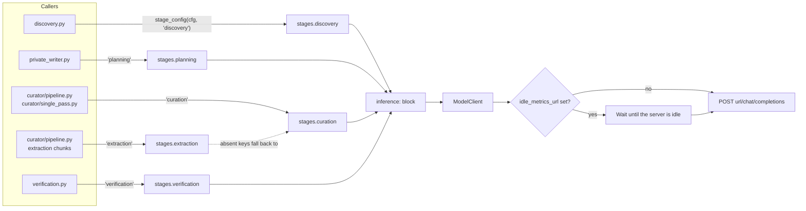
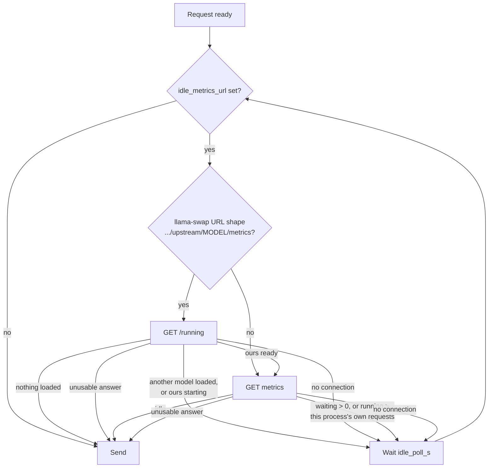

# Models

Every model call in the system goes through one client, `curator/model.py:ModelClient`, to one OpenAI-compatible chat-completions endpoint. Five places may each override that endpoint or model. There is no second provider to fall back to: if the endpoint is down, work waits or stops `retryable` with its progress kept.

## Contents

- [The endpoint](#the-endpoint)
- [Per-stage overrides](#per-stage-overrides)
- [Requests](#requests)
- [Retries](#retries)
- [Outages](#outages)
- [The idle gate](#the-idle-gate)
- [Token and character budgets](#token-and-character-budgets)

## The endpoint

The `inference:` block of the curator config (`curator/config.py:InferenceConfig`) names the endpoint:

| Key | Default | Meaning |
|---|---|---|
| `url` | `http://localhost:8000/v1` | Base URL; requests go to `<url>/chat/completions` |
| `model` | `Qwen/Qwen3-32B` | Model id sent with each request |
| `api_key_env` | `CURATOR_INFERENCE_API_KEY` | Name of the variable holding the API key |
| `serving_context_tokens` | `262144` | The server's context length |
| `serving_max_output_tokens` | `8192` | The server's output limit |
| `prompt_token_target` | `16384` | Target prompt size per request |
| `output_token_target` | `4096` | Target output size per request |
| `timeout_s` | `300.0` | Request timeout |
| `retries` | `2` | Retries after the first attempt |
| `concurrency` | `1` | Parallel requests within one job |
| `enable_thinking` | `false` | Sent as `chat_template_kwargs.enable_thinking` |
| `thinking_budget_field` | `thinking_token_budget` | Request key that bounds thinking tokens; some hosted APIs use `thinking_budget` |
| `thinking_token_budget` | `2048` | Thinking tokens on reasoning tasks, capped at half the output target |
| `chars_per_token` | `2.5` | The one token-to-character ratio for every derived budget |
| `request_priority` | `null` | Sent as top-level `priority` when set (vLLM priority scheduling; lower runs first) |
| `idle_metrics_url` | `null` | Turns on the idle gate (below) |
| `idle_poll_s` | `15.0` | Seconds between idle-gate checks |

The API key is read from the environment variable named by `api_key_env`, or else from the credentials file (`credentials_file`, default `~/.config/brain-curator/credentials.env`, a `KEY=VALUE` file with mode 600). Keys never go in the config file.

`CURATOR_INFERENCE_URL`, `CURATOR_INFERENCE_MODEL` and `CURATOR_INFERENCE_KEY_ENV` override `url`, `model` and `api_key_env` from the environment.

## Per-stage overrides



`stages:` maps a stage name to any `inference` keys. `curator/config.py:stage_config(cfg, stage)` returns a copy of the config with that stage's keys layered over `inference`; the global config is never changed. A stage with no entry uses `inference` unchanged. `extraction` first takes the `curation` overrides, then its own (`STAGE_FALLBACK = {"extraction": "curation"}`). When the overrides change the prompt target, the prompt character budget is derived again for that stage.

Who uses which stage:

| Stage | Caller |
|---|---|
| `discovery` | `discovery.py`: relevance and authority judgments on candidate pages |
| `planning` | `private_writer.py`: planning read-only commands |
| `curation` | `curator/pipeline.py`, `curator/single_pass.py`: placement, drafting, review, grounding |
| `extraction` | `curator/pipeline.py:Pipeline._stage_extract`: claim extraction chunks |
| `verification` | `verification.py`: judging whether a page answers a gap |

An unknown stage name or key fails when the config loads, not at call time. Example: a small model for discovery, a larger one for planning and curation, a model from a different family for verification:

```yaml
stages:
  discovery:    {model: small-model}
  planning:     {model: large-model}
  curation:     {model: large-model}
  verification: {model: other-family-model}
```

## Requests

`ModelClient.chat` sends a non-streaming chat completion with a system and a user message. JSON tasks use `temperature: 0.2`; tasks that need a JSON object also send `response_format: {"type": "json_object"}`. `max_tokens` is the effective output target. A reply with `finish_reason: "length"` raises `OutputTruncated`, and the caller splits the work. `ModelClient.chat_json` parses the reply defensively and re-asks a bounded number of times when the JSON is malformed.

Within one job, at most `inference.concurrency` requests are in flight. The worker-wide ceiling is `limits.parallel_jobs × inference.concurrency`, plus the gap worker's own discovery, planning and verification calls.

## Retries

`ModelClient.chat` makes up to `retries + 1` attempts. Each attempt is charged to the job's call counter before it is sent. Between attempts it sleeps 2 s, then 4 s, never more than 5 s.

| Response | What happens |
|---|---|
| 200 | Return the reply |
| 408, 409, 425, 429, 500, 502, 503, 504 | Retry; after the last attempt, a transient `ModelError` (the job ends `retryable`) |
| 401 or 403 | Non-transient `ModelError`: credentials rejected |
| Any other status | Non-transient `ModelError` |
| Connection-level failure | Curator jobs wait out the outage (below), then retry without spending an attempt; other callers retry like a recoverable status |

## Outages

Curator jobs build their client with `wait_out_outages=True` (`curator/pipeline.py`). When such a request fails at the connection level (refused, no route, timeout, dropped connection), `ModelClient._wait_out_outage` probes `GET <url>/models` every `idle_poll_s` seconds until any HTTP answer comes back, then retries the request without counting an attempt. The wait has no timeout, honors cancellation, and is recorded as `usage.idle_wait_seconds`, not as active time. An endpoint that answers with an HTTP error is up, so that case uses the normal bounded retries instead.

The gap worker's own calls do not wait. An unreachable model makes discovery back off 5 minutes and the private writer 1 hour (see [knowledge-loop.md](knowledge-loop.md#4-scheduling)).

## The idle gate

When the model runs on a local GPU server that other workloads also use, the curator should use only idle capacity. Setting `idle_metrics_url` to the server's Prometheus metrics URL turns on a gate in front of every request (`ModelClient._wait_until_idle`):



- `curator/model.py:parse_vllm_load` reads vLLM's running and waiting request gauges. The gate subtracts this process's own in-flight requests, so it does not wait for itself.
- With a llama-swap URL (`<base>/upstream/<model>/metrics`), the gate first asks `<base>/running`. It does not touch `/upstream` while another model is loaded, because polling there could make llama-swap unload that model. The `<model>` in the URL must equal the block's `model`, checked when the config loads (`curator/config.py:_validate_gate_models`).
- No connection means the server is down, so the gate waits rather than sending a request that would fail. An unusable answer (an HTTP error or a body it cannot parse) fails open and lets the request through. Each is logged once per client.
- The wait has no timeout and is not active time.

`request_priority` complements the gate on a vLLM server started with priority scheduling: background curator work can be sent with a high number (for example `100`) so interactive requests at the default `0` run first.

## Token and character budgets

Prompts are sized in characters, converted from token targets with one ratio, `inference.chars_per_token` (default 2.5):

- `effective_prompt_target = max(1024, min(prompt_token_target, 0.8 × serving_context_tokens))`
- `effective_output_target = max(256, min(output_token_target, serving_max_output_tokens))`
- `prompt_char_budget = effective_prompt_target × chars_per_token` (16,384 × 2.5 = 40,960 characters with the defaults)
- `output_char_budget = effective_output_target × chars_per_token`

`limits.prompt_char_budget` defaults to `0`, which means "derive it from the inference block". A value set explicitly in the config is never overwritten.

Job-level limits (`limits:`, `LimitsConfig`), for multi-stage jobs:

| Key | Default |
|---|---|
| `max_sources` | 50 |
| `max_source_bytes` | 67,108,864 (64 MiB) |
| `max_job_bytes` | 536,870,912 (512 MiB) |
| `max_active_seconds` | 7,200 (2 h) |
| `max_model_calls` | 200 |
| `fetch_concurrency` | 4 |
| `connect_timeout_s` | 10.0 |
| `fetch_timeout_s` | 120.0 |
| `transient_retries` | 2 |
| `max_repair_passes` | 2 |
| `prompt_char_budget` | 0 (derived) |
| `parallel_jobs` | 1 |

Single-pass jobs use the `single_pass:` limits instead; see [curator.md](curator.md#single-pass-and-multi-stage). Reaching a limit stops the job `retryable` with its work kept.
