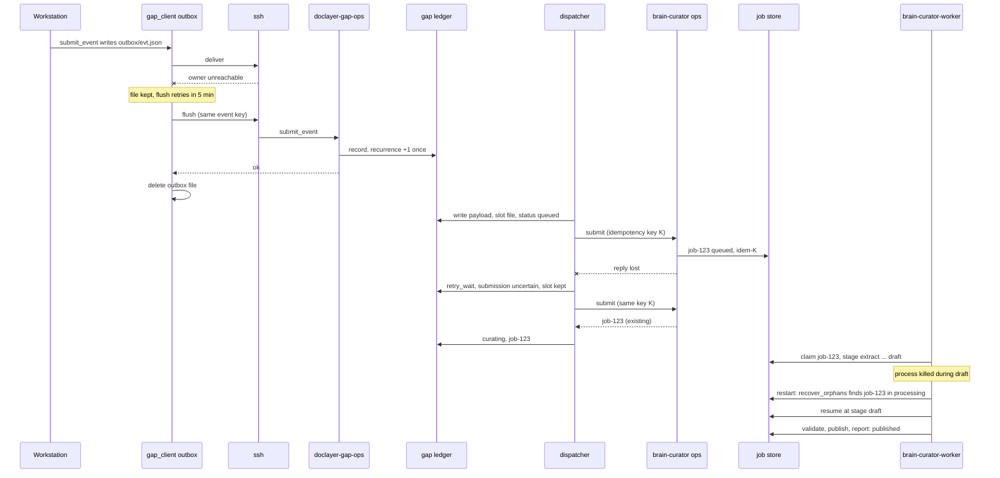

# Reliability

The curator and the gap loop run unattended for days. They must survive crashes, lost network replies and model outages without losing work, duplicating a job, or spending a budget twice. This page describes how. None of it uses a database: state is files, written atomically, guarded by file locks.

## Contents

- [Durable job store](#durable-job-store)
- [Versioned state](#versioned-state)
- [The worker loop](#the-worker-loop)
- [The ops wire](#the-ops-wire)
- [Reaching the worker from another machine](#reaching-the-worker-from-another-machine)
- [Durable dispatch slots](#durable-dispatch-slots)
- [Budgets charged before I/O](#budgets-charged-before-io)
- [Negative cache semantics](#negative-cache-semantics)
- [Crash and resume, end to end](#crash-and-resume-end-to-end)

## Durable job store

`curator/jobstore.py:JobStore` keeps every job in its own directory under `paths.jobs`:

```text
<job_id>/state.json        the job state, replaced atomically
<job_id>/summary.md        the completion digest
<job_id>/drafts/           draft pages (never canonical)
<job_id>/evidence.jsonl    retained evidence records
<job_id>/staging/          files the client transferred
<job_id>/.claim            flock: one processor per job
index/idem-<key>.json      idempotency key -> job id
index/input-<digest>.json  published inputs, for repeat detection
index/locks/.worker.lock   the global worker lock
index/locks/.publish.lock  one publication at a time
corrections.jsonl          operator corrections; never expire
```

Every write goes through `curator/jobstore.py:atomic_write_text`: write a temporary file, `fsync` it, `os.replace` it over the target, then `fsync` the directory. A crash leaves either the old file or the new one, never half of one.

The gap ledger (`gaps.py:GapLedger`) uses the same helpers and the same lock class. Each gap is `gaps/<gap_id>/record.json` plus an append-only `events.jsonl` that keeps its last 500 lines (`gaps:GapLedger._bound_events`). A record that cannot be parsed is moved to `quarantine/` and reported in the digest, and answering continues.

## Versioned state

`curator/state.py:JobState` carries `schema_version` (`STATE_SCHEMA_VERSION = 1`). Loading a state file with any other version raises an error instead of guessing. A job records its current stage, the stages it finished, its limits, its usage counters, every source and page change with its own status, and, during publication, its publication identity (branch, push, commit, pull request, merge). That is enough to resume after a restart and to report partial publication honestly.

## The worker loop

`brain-curator-worker` (`curator/worker.py`) polls the job store every `--poll-interval` seconds (default 10):

- It holds the global worker lock, so only one worker process serves a job store.
- It claims queued jobs in submission order and runs up to `limits.parallel_jobs` of them, one thread and event loop each. Each job holds its own `.claim` flock.
- On start-up, `curator/worker.py:recover_orphans` finds jobs left in `processing`, `validating` or `publishing` whose claim is free (their process died) and resumes them at their recorded stage.
- A job whose thread raises ends `retryable` with `worker crash: ...` in its error (`curator/worker.py:_record_crash`), or `cancelled` if a cancel was requested. It never stays `processing` forever.
- On `SIGTERM` or `SIGINT` it stops claiming and waits for running jobs. systemd allows 120 seconds (`TimeoutStopSec=120`); a job cut off then resumes from its last checkpoint at the next start.
- It also expires source caches and finished jobs on the retention schedule.

Inside a job, `curator/pipeline.py:Pipeline.run` persists after every stage and checks for cancellation between stages and between sources. Workload limits raise `curator/state.py:BudgetExceeded`, which ends the job `retryable` with all work kept and a note naming the limit. Time spent queued, offline, or waiting at the model's idle gate is not counted as active time.

## The ops wire

Clients never run code on the worker except one fixed entry point: `brain-curator ops <operation>` (`curator/ops.py:handle`). It reads one JSON object from stdin and prints one JSON object. Operations: `submit`, `status`, `result`, `continue`, `resume`, `cancel`, `correct`, `list`, `inspect`, and `retire_allowance`, which only the gap dispatcher uses. Submitted text is never put into a shell command. Malformed input returns `{"ok": false, "error": ...}`, never a traceback.

The gap ledger has its own fixed entry point, `doclayer-gap-ops` (`gap_ops.py`), with a 16,384-byte request limit.

Replies are parsed strictly on the client. `curator_reply.py:parse_submit_reply` and `parse_job_reply` reject a reply that lacks a job id or status, or that names a different job than the one asked about. A foreign or malformed reply is treated as uncertain, never as success.

## Reaching the worker from another machine

`curator/transport.py:SshTransport.call`:

1. Stages any local files on the worker with a `tar` pipe over ssh. Arguments are passed as arrays; no file name or content is interpolated into a shell string.
2. Runs `ssh -o BatchMode=yes -o ConnectTimeout=<ssh.connect_timeout_s> <ssh.host> <ssh.remote_command> <operation>` with the JSON request on stdin, under `ssh.command_timeout_s`.
3. Raises `TransportError` on any ssh failure. It never invents a result.

A submit that times out after the worker accepted it is still durable on the worker. Its idempotency key is derived from the content, so the retry returns the same job (`curator/ops.py:derive_idempotency_key`).

`curator/transport.py:transport_for` picks `LocalTransport` when `ssh.host` is empty or names this machine, or when `BRAIN_CURATOR_LOCAL=1`.

Gap events take a similar path with one more layer. `gap_client:GapClient.submit_event` writes the event to a local outbox file named from its event key before trying delivery. If delivery fails, the file stays, and `doclayer-gaps flush` retries it later with the same event key. The ledger ignores an event key it has already seen, so a delivery whose reply was lost is never counted twice.

## Durable dispatch slots

`dispatcher.py:GapDispatcher` submits gaps to the curator. Its rule: **when the outcome is uncertain, keep the exact attempt.**

- Each active submission is a slot file `<ledger>/active-submissions/<gap_id>.json`. There are at most `gap_worker.max_active_jobs` slots.
- The payload, including its idempotency key from `dispatcher:attempt_key`, is written to the gap record and staged in `<ledger>/spool/` before the request is sent. Policy changes later never rewrite a staged payload.
- If the submit reply is lost or malformed, the gap goes to `retry_wait` with `submission.state = "uncertain"` and the slot is kept. The next attempt resends the identical payload, and the curator's idempotency index returns the original job if it exists.
- A slot is released only when the job reaches a terminal status, or when the dispatcher retires the job's allowance with an immutable receipt (`dispatcher:GapDispatcher.retire_exhausted`). A failure to read the job's status never releases a slot.
- A job that has started publishing is never retired or replaced. It is resumed on a backoff of 5 minutes doubling to 6 hours, with no limit on tries (`dispatcher:GapDispatcher.resume_publication`).

## Budgets charged before I/O

A model call is charged before its HTTP request is sent, never after it succeeds. If the process dies mid-request, the charge stands, so a crash loop cannot spend more than its grant.

- In the curator, `curator/model.py:ModelClient._charge_call` increments the job's call counter before each attempt and raises `BudgetExceeded` at the limit.
- In the gap loop, `gap_budget.py:ResourceBudget.reserve_attempt` records an immutable grant for each dispatch attempt, and `ResourceBudget.consume_model` charges discovery and verification calls before each request.
- Grants and charges stay on disk under `<ledger>/budgets/` for audit. There are no daily caps (see [knowledge-loop.md](knowledge-loop.md#4-scheduling)); the per-job grant is `DOC_LAYER_GAP_MODEL_CALLS_JOB` (default 50).

A model outage does not burn the budget: when a request fails at the connection level, the client waits for the endpoint to come back without spending an attempt (see [models.md](models.md#outages)).

## Negative cache semantics

`negative_cache.py` is a cache, not a record of truth:

- It stores only observed misses: the source answered, and the answer did not help. Outages, lag and withheld evidence are never stored.
- Each entry is bound to the evidence generation (vault `HEAD`, index commit, policy version). Any change makes old entries miss.
- Entries expire after six hours; the file holds at most 512 entries.
- Losing the file costs one repeated lookup, so it is written without `fsync`.

## Crash and resume, end to end


