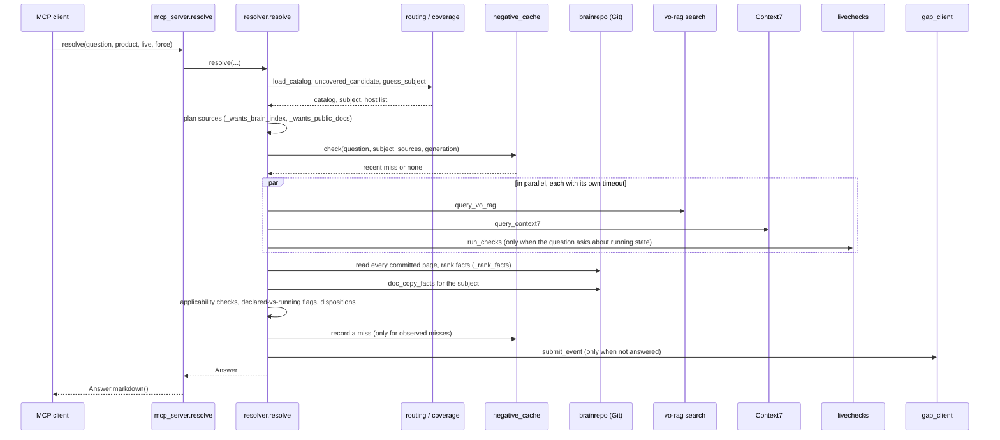

# The resolver

The resolver turns one question into one answer. It reads the vault from Git, asks the vector index and Context7 in parallel when they can help, runs read-only live checks when the question is about running state, and renders one Markdown answer in which every fact names its source and date.

The entry point is `doclayer.resolver.resolve(question, *, product=None, live=None, repo=None, force=None, capture=None)`. The MCP tool `resolve` in `mcp_server.py` calls it and returns `Answer.markdown()`.

## Contents

- [One question, end to end](#one-question-end-to-end)
- [Routing](#routing)
- [The coverage catalog](#the-coverage-catalog)
- [Source planning](#source-planning)
- [The negative cache](#the-negative-cache)
- [Applicability and scope](#applicability-and-scope)
- [Declared vs observed](#declared-vs-observed)
- [The answer format](#the-answer-format)
- [Dispositions](#dispositions)
- [Gap capture](#gap-capture)

## One question, end to end



The parallel step uses `asyncio.gather` over the planned tasks. Each source has a timeout: `DOC_LAYER_TIMEOUT_VO_RAG_S` (default 25 s), `DOC_LAYER_TIMEOUT_CONTEXT7_S` (40 s) and `DOC_LAYER_TIMEOUT_LIVE_S` (15 s). A source that fails or times out becomes an `unavailable:` line in the answer and a `source_unavailable` disposition. It never empties the answer.

## Routing

`routing.route_prompt(prompt, catalog, hosts)` returns a `RouteResult` with an intent, the subjects it found, the sources it would use, a reason and whether the prompt may record a gap. It uses no model, no network and no curator. It is fast enough to run in the prompt hook (see [agent-integration.md](agent-integration.md)).

Intents, from the constants in `routing.py`:

| Intent | Meaning |
|---|---|
| `local_environment` | A question about the operator's own hosts, installs or accounts |
| `public_docs` | A question about how a public product works |
| `mixed_local_public` | Both at once |
| `code_task` | Work on code in the current repository; no lookup |
| `explicit_brain` | An explicit request to ask the brain |
| `ambiguous` | Not enough to decide; no lookup is forced |

Source selectors, also from `routing.py`: `brain_git`, `brain_index`, `doc_copies`, `public_docs`, `live_checks`.

Matching rules that keep routing selective:

- Subjects match on complete canonical names and declared aliases only. A filename fragment such as "tools" never matches alone.
- `routing.routing_text` drops fenced code, quoted lines, URLs and pasted reports before routing, so a host name inside a log paste does not trigger a lookup.
- Two aliases that point at different subjects stay ambiguous.
- A question about several subjects gets the union of their routes.

The MCP tool `route` exposes the same decision without calling any source. Real output against the demo vault for "Which port does Postgres listen on for the example app on app1?" (`<commit>` stands for the full hash of the commit the catalog was built from):

```text
intent: local_environment
subjects: app1, example-app-deployment
sources: brain_git, brain_index
coverage: ok @ <commit>
gap capture eligible: False
reason: private factual context; consult local declarations and evidence, not public documentation
```

## The coverage catalog

The catalog (`coverage.py`) lists the subjects the brain can route to. It is derived, never hand-maintained:

1. Every committed page under `wiki/` and `infra/` becomes a subject, named by its `product:` frontmatter or its file stem. Its `title:` and `aliases:` become names it can be matched by.
2. The committed routing policy `doclayer/routing-policy.yaml` adds what pages cannot say: extra aliases, `facets`, `related` subjects, `public_docs` roots, `live_checks` names, known `hosts`, `exclusions`, `local_first` subjects and `early_projects`.
3. Each folder `sources/<product>/` that holds at least one Markdown copy marks that product as having doc copies.

A policy subject with no committed page is kept with `page_status: policy`. It can be matched, but it never counts as coverage.

`coverage.load_catalog` reads the catalog from `~/.cache/doclayer/catalog-<head>-<digest>.json`, keyed by the vault's `HEAD` and the policy file. A missing or corrupt cache triggers one rebuild from committed bytes. If the rebuild fails, it returns an older snapshot marked `stale`, or a catalog with status `unknown`. It never returns an empty catalog, because an empty catalog would make every subject look uncovered and flood the gap ledger.

`early_projects` in the policy names projects too new to document. A question about one gets a flag pointing at the project's folder and records no gap (`coverage.early_project`).

## Source planning

`resolve` decides which sources to call before calling any:

- **Git** (`brain_git`) is always read unless the subject is clearly uncovered. It reads every committed Markdown page except `log.md`, `sources/` (read separately as doc copies) and the repository's own files: `README.md`, `CLAUDE.md`, `LICENSE`, `docs/`, `doclayer/` and `.github/` (`brainrepo:is_brain_page`, used by `BrainRepo.markdown_paths`). Exact facts such as versions, hosts and ports come from pages read at a fixed commit (`brainrepo.BrainRepo`), not from vectors.
- **Vector search** (`brain_index`) runs unless the question names a public subject the catalog clearly does not cover (`_wants_brain_index`). An `unknown` or `stale` catalog always allows the search. `resolver:query_vo_rag` drops any index hit whose path is repository meta, so these docs never come back as search evidence either.
- **Context7** (`public_docs`) runs only for questions that public documentation can answer (`_wants_public_docs`). It is skipped for private questions, host subjects and running-state questions. The skip and its reason appear in the answer.
- **Doc copies** (`doc_copies`) are read for the subject from `sources/<subject>/` (`doc_copy_facts`). A copy older than `DOC_LAYER_STALE_COPY_DAYS` (default 60 days) is flagged stale.
- **Route facts** come from an optional JSON routing config (`DOC_LAYER_ROUTE_CONFIG`) when the question asks about routes.
- **Live checks** run when `live=True`, or when the question contains a running-state word such as "running", "current", "deployed" or "live" (`LIVE_HINTS`). Only checks that apply to the subject run (`_applicable_live_checks`).

A Context7 result is not trusted just because it returned text. When doc copies supplied facts, the resolver checks whether the Context7 text states any of them. If not, it marks the result `lacks_facts` and withholds it.

## The negative cache

`negative_cache.NegativeCache` remembers that a lookup recently failed, so an agent asking the same thing again does not repeat the same network calls.

- Only an observed miss is cached: the source answered, and the answer did not help. Outages, index lag, ambiguous applicability and withheld evidence are never cached.
- An entry is bound to the subject, the normalized question, the requested scope (edition, version, region), the sources that were checked, and the evidence generation: the vault `HEAD`, the index commit and the policy version (`negative_cache.evidence_generation`). A new commit or a re-index invalidates it.
- Entries expire after six hours (`DEFAULT_TTL_S = 6 * 3600`). The file keeps at most 512 entries.
- A hit skips only the network sources it covers. Git reads and live checks are never suppressed.
- The answer says what happened: "recent lookup did not answer this request (date; checked ...); not a fact about the subject". `resolve(force=True)` bypasses the cache.

## Applicability and scope

A fact is only useful if it applies to what was asked. `applicability.py` extracts the scope a question names, such as a platform (host), an edition, a version or a region, and checks each candidate fact against it.

Host recognition (`applicability.known_identities`) combines:

- host aliases from `~/.ssh/config`, including `Include` files (`coverage.ssh_host_aliases`, cached separately);
- hosts declared in the routing policy's `hosts:` map;
- host subjects in the catalog;
- the fleet page `infra/fleet-hosts.md`, whose `- **name** ...` bullets and headings (`coverage.fleet_host_blocks`) tie each host already known from the sources above to its address and the services recorded for it;
- `DOC_LAYER_SSH_HOST`.

The result is cached for 30 seconds. In the demo vault, "app1" in a question is recognized from the policy's `hosts:` map and grouped with its `infra/fleet-hosts.md` entry, so the question routes as `local_environment`.

`question_scope.private_question` decides whether a question is about a private installation. Paths such as `/etc/...`, phrases such as "my server", "installed on", a recognized host, or the operator's `local_need_terms` make a question private. A private question never goes to Context7 or public discovery, even when it names a public product.

When no source supplies a fact that matches the requested scope, the answer says so explicitly: "requested applicability is unknown: platform=worker1; other platforms, editions or versions do not establish the requested facts".

## Declared vs observed

A page declares how something is set up. A live check observes how it is running. The two are kept apart:

- A page may carry a `## Facts` table with three columns: Fact, Declared and Observed. `brainrepo.fact_rows` reads only tables under a heading named "Facts". The Observed cell holds `YYYY-MM-DD: value` or `—`.
- A live check (`livechecks.py`) returns a `LiveResult` with a name, a UTC timestamp and one or more checked values. It is rendered as `live check @ 2026-10-12T22:48:57Z`.
- `resolver.declared_vs_running_flags` compares live results with values declared in `wiki/` and `infra/` pages and raises a flag when they differ. It skips sections marked as history.
- `resolver.stale_observation_flags` flags any Observed value older than `DOC_LAYER_STALE_COPY_DAYS`.

A live check never overwrites a declared value. Both appear, and the flag points at the disagreement.

The implemented checks are `vo-rag-release`, `vo-rag-api`, `litellm-container`, `vo-rag-brain-collection` and `token-plan-endpoint`. A check whose settings are empty reports "not configured (DOC_LAYER_... is empty)" instead of failing. `uv run python -m doclayer.livechecks [name ...]` runs them from the command line.

## The answer format

`Answer.markdown()` renders sections in a fixed order. This is the real answer to "Which port does Postgres listen on for the example app on app1?" against this checkout, produced offline with vector search and Context7 pointed at a closed port. `<commit>` stands for the first eight characters of the commit hash in the real output. It is trimmed, with notes added on the right:

```text
# Answer: Which port does Postgres listen on for the example app on app1?     <- subject (or "Answer") and the question

**Flags**                                                                      <- problems first
- ⚠ index state unknown: brain_sync has never run or its state file is missing

## Answer                                                                      <- facts, each with source and date

**Fleet hosts (source extract with full context) — infra/fleet-hosts.md@<commit> · page text · recorded 2026-10-12**
source authority metadata {"authority": "canonical configuration record; running state requires observation", ...}

> ## Hosts and roles
> - **app1** — `192.0.2.20` application and GPU inference VM. Debian 12. Serves an OpenAI-compatible inference endpoint on port 8000 and a Postgres 16 database on port 5432 for the example app ([[wiki/example-app-deployment]]).
  ...                                                                          <- the whole governing section is quoted, never clipped

**Unknown — unresolved automatic coverage** (may miss paraphrases; this is not "unsupported"):
- automatic coverage unresolved for: listen (...)                             <- what could not be matched, stated as unknown

## Search (vo-rag over vo_rag_brain_v1)
- unavailable: ConnectError: All connection attempts failed                    <- a down source is named, not hidden

## Context7
- library: n/a
- result withheld: requested applicability or facts are not established

## Dispositions                                                                <- machine-readable outcome
- outcome: answered, index_lag, source_unavailable
- checked sources: brain_git, brain_index
- skipped public_docs: local/private question; public documentation cannot establish local facts
```

Source tags used in answers:

| Tag | Meaning |
|---|---|
| `path@commit` | A vault page read from Git at that commit |
| `URL@fetch-date` | A doc copy in `sources/`, with the date it was fetched |
| `Context7 (library; page revision unknown)` | A Context7 result |
| `live check @ time` | A live check and the moment it ran |
| `path@revision · indexed evidence` | A passage from the vector index, used only when Git did not supply facts |

Evidence is delivered whole. `resolver_context.py` allows 65,536 characters per evidence unit and 262,144 per answer. A unit that does not fit is withheld with a note, and the rest of the answer still renders.

## Dispositions

`resolver._dispositions` sets one or more of these outcomes:

| Disposition | Set when |
|---|---|
| `answered` | The facets the question asks for are all covered by delivered evidence |
| `partial` | Some evidence was found, but not for every requested facet |
| `not_found_in_checked_sources` | Sources were checked or skipped and nothing applicable came back |
| `source_unavailable` | Vector search, Context7, a live check or Git failed |
| `index_lag` | The vector index is behind Git, or its state is unknown |
| `evidence_withheld` | Some evidence was too large to deliver whole |
| `retrieval_suspected` | Pages exist for the subject, the index answered without error, yet nothing applicable came back |

A lexical miss alone never proves that a document is absent.

## Gap capture

When the outcome is not a plain `answered`, `resolver._maybe_capture_gap` records the question in the gap ledger through `gap_client.GapClient`. It picks a need class from the dispositions: an uncovered subject or a partial answer is `missing_coverage`, `retrieval_suspected` is `retrieval_defect`, an outage or lag is `infrastructure`. Capture is skipped for code tasks, for `capture=False` (verification runs use this so they do not create their own demand) and when `DOC_LAYER_GAP_CAPTURE=0`. Capture never raises. [knowledge-loop.md](knowledge-loop.md) follows the gap from there.
