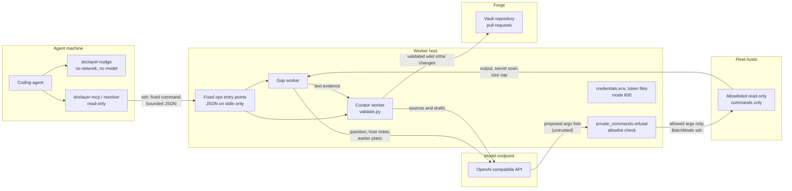

# Security model

The system reads from machines, the web and a model, and writes to a Git repository without a reviewer in the loop. This page describes what each part may do, where the trust boundaries are, and how secrets are kept out.

## Contents

- [Trust boundaries](#trust-boundaries)
- [What runs where](#what-runs-where)
- [The command allowlist](#the-command-allowlist)
- [Secret-shaped output is withheld whole](#secret-shaped-output-is-withheld-whole)
- [Read roots](#read-roots)
- [Bounded input and output](#bounded-input-and-output)
- [Untrusted text](#untrusted-text)
- [No credentials in the vault](#no-credentials-in-the-vault)
- [Write scope](#write-scope)

## Trust boundaries

The boundaries:

1. **Model output never reaches a shell.** The model proposes argv lists. Code checks each one against the allowlist and runs only what passes.
2. **Clients reach the worker only through fixed commands.** `brain-curator ops <operation>` and `doclayer-gap-ops` read one JSON document from stdin. Nothing a client sends is put into a shell string.
3. **The curator writes only validated changes inside its scope.** Paths, frontmatter, links and corrections are checked by code before anything is committed.
4. **Private material goes only to the configured model.** Command outputs leave the worker only as part of curator prompts to the one endpoint in the curator config, and as text on pages in the vault.

## What runs where

| Component | Runs on | Reads | Writes |
|---|---|---|---|
| `doclayer-nudge` | Agent machine | Catalog cache, ssh config, negative cache | Local gap outbox |
| `doclayer-mcp` (resolver) | Agent machine | Vault clone, search API, Context7, live checks | Local outbox, negative cache |
| Live checks (`livechecks.py`) | Agent machine | Fixed read-only probes over ssh and HTTP GET | Nothing |
| `doclayer-gap-ops` | Worker host | stdin | Gap ledger |
| `doclayer-gap-worker` | Worker host | Ledger, vault clone, model, allowlisted commands on fleet hosts | Ledger, curator submissions |
| `brain-curator-worker` | Worker host | Job store, sources, model | Job store, curator branches and pull requests |
| `brain-vault-sync` | Every vault consumer | The forge | Fast-forwards registered clones only |
| `doclayer-fetch` | Wherever it is scheduled | Vendor doc pages | `sources/<product>/`, its recipe, a branch and pull request |

## The command allowlist

`private_commands.py:refusal(host, argv, hosts=..., resolved=...)` returns `None` for an allowed command or a reason for refusing it. A command is refused when:

- the host is not in `private_writer.hosts`;
- any argument is empty or not a string;
- any argument contains a shell metacharacter (`|`, `;`, `&`, `<`, `>`, a backtick, a newline, `$(`, or `${` other than dpkg-query's `${Package}`, `${Version}`, `${Status}`, `${binary:Package}`);
- any argument after the command names a secret-bearing path (`.ssh`, `.gnupg`, `credential`, `secret`, `token`, `.env`, `id_rsa`, `id_ed25519`);
- the command is not one of these forms (`private_commands._FORMS`):

| Command | Allowed form |
|---|---|
| `dpkg-query` | `-W [-f=FORMAT] PKG...` |
| `apt-cache` | `policy PKG...` |
| `snap` | `list [NAME]` |
| `flatpak` | `list` |
| `command` | `-v NAME` |
| `NAME --version` | only for a `NAME` that `command -v` resolved earlier in the same plan to a file in a system bin directory; the resolved path runs, not the name |
| `uname` | `-a` |
| `lsb_release` | `-a` |
| `hostname`, `lsblk` | no arguments |
| `df` | `-h [PATH]` |
| `findmnt` | no arguments, `PATH`, or `--target PATH` |
| `nvidia-smi` | `--query-gpu=FIELDS --format=csv[,noheader]` |
| `systemctl` | `[--user] is-active\|is-enabled UNIT...`, `list-units --no-pager [--all] [PATTERN]`, `cat UNIT`, `show UNIT -p PROP[,PROP]` |
| `docker` | `ps [-a] --format TEMPLATE`, `inspect [--type container] -f TEMPLATE NAME`, with only listed `{{.Field}}` references |
| `git` | `-C DIR rev-parse [--short\|--abbrev-ref] HEAD`, `rev-parse --show-toplevel`, `log --oneline -n N` (N ≤ 50), `--no-optional-locks -C DIR status --short`, `branch --show-current` |
| `ls` | `-la PATH` |
| `stat` | `PATH` |
| `head` | `-n N PATH`, N ≤ 200, only under the read roots and only for `.md`, `.txt`, `.gradle`, `.gradle.kts`, `.toml`, `package.json`, `go.mod` |
| `find` | `PATH... ` with only `-maxdepth N`, `-name`, `-iname`, `-path`, `-type f\|d\|l`, `-mtime [+-]N` |
| `ps` | `-eo pid,comm` or `-eo pid,ppid,comm` |
| `free` | `-h` or `-m` |
| `ss` | `-ltn`, `-lun` or `-ltnu` |
| `id`, `groups` | `[USER]` |

Paths must be absolute and contain no `..`. `find` actions such as `-exec` and `-delete` are refused. `grep`, `cat`, `tree`, `ls -R`, `sudo` and anything unlisted are refused. `tests/test_private_commands.py` and `tests/test_public_defaults.py` pin these rules.

`private_commands:run_command` runs an allowed command as `ssh -o BatchMode=yes -o ConnectTimeout=5 -- HOST COMMAND`, or `sh -c COMMAND` on the worker itself, with stdin closed and a timeout. For `head`, the remote command first resolves symlinks with `readlink -f` and checks the read roots, the file kind and the secret-path words again on the real path (`private_commands:remote_string`).

Live checks (`livechecks.py`) are separate: a fixed set of five named probes written in the code, never built from a question.

## Secret-shaped output is withheld whole

`private_commands:possible_secret` scans stdout and stderr of every command. The output is withheld when it contains:

- any PEM key header (`-----BEGIN <anything> KEY-----`, public or private);
- an assignment to `password`, `passwd`, `secret`, `token` or `api_key` (any case, `=` or `:`);
- credentials in a URL (`scheme://user:pass@`);
- a run of 32 or more characters with lower case, upper case and digits and a Shannon entropy of at least 4.0 bits per character.

A withheld output is dropped whole and recorded only as "withheld: possible secret". It is never redacted, because a redaction that misses part of a secret would still leak it. The planner sees which commands were withheld and is told not to repeat them.

## Read roots

`head` may read files only under `DOC_LAYER_PRIVATE_READ_ROOTS` (default `~/git/:~/src/`, `:`-separated), and only notes and build manifests. `*.properties` files are excluded on purpose, because they often hold signing passwords and keys.

## Bounded input and output

| Bound | Value | Where |
|---|---|---|
| Prompt routed by the hook | 20,000 characters | `nudge.MAX_PROMPT_CHARS`, `routing.MAX_PROMPT_CHARS` |
| Gap question | 2,000 characters | `gaps:GapLedger._capture_event` |
| Gap ops request | 16,384 bytes | `gap_ops:main`, `gap_client:GapClient._remote` |
| Gap client outbox | 8 MiB | `gap_client.OUTBOX_LIMIT` |
| Commands per private plan | `private_writer.max_commands` (30) | `private_writer:_plan` |
| Output per command stream | `private_writer.output_cap_bytes` (131,072 bytes), cut with a note | `private_commands:run_command` |
| Command timeout | `private_writer.command_timeout_s` (60 s) | `private_commands:run_command` |
| Discovery fetch | 4 MiB per page, 40 requests, 15 seeds | `discovery.py` |
| Curator source | 64 MiB per source, 512 MiB per job | `limits.max_source_bytes`, `limits.max_job_bytes` |
| Evidence in an answer | 65,536 characters per unit, 262,144 per answer | `resolver_context.py` |

## Untrusted text

Source pages, pasted text and model replies are data. The curator's prompts say so, and the code enforces it: model-proposed paths, identities and edits are re-checked by deterministic code (`curator/validate.py`), and instructions inside a source cannot change a job's intent, paths or rules. Verification prompts also tell the model to ignore embedded instructions (`verification.py`).

Every URL the curator or discovery fetches has each redirect checked before it is followed, and downloads stream with byte caps. Login, signup, cart, checkout and cookie pages are excluded from gap imports.

## No credentials in the vault

- Never write a secret value into a page. A page that refers to a secret is `privacy: credential` and stays local.
- The model API key is read from an environment variable or `~/.config/brain-curator/credentials.env` (mode 600), never from the config file. `CuratorConfig.credentials` is never logged.
- Forgejo tokens are read from token files (mode 600). The vo-rag key is read from `DOC_LAYER_VO_RAG_KEY_FILE`; a missing key degrades the search, it is not an error.
- The vault-sync installer never relays Git's output, because a remote URL can carry credentials.
- Gap events carry bounded technical detail only; the `record_gap` tool tells agents not to send transcripts or secrets.

## Write scope

- The curator writes only under `publish.allowed_prefixes` (`wiki/`, `infra/`), never files named in `publish.denied_names` (`index.md`, `log.md`), and never deletes or renames a page.
- Private curator jobs are accepted only from `submitted_by: gap-worker-private`, only in single-pass mode, only with text evidence, and with no URLs, files or manifests (`curator/ops.py`).
- The doc fetcher self-merges only changes to `sources/<product>/` and its recipe.
- `brain-vault-sync` only fast-forwards registered clones and never resets, stashes or commits.
- Every write to the forge is a pull request and a merge commit, so `git revert` undoes it.
