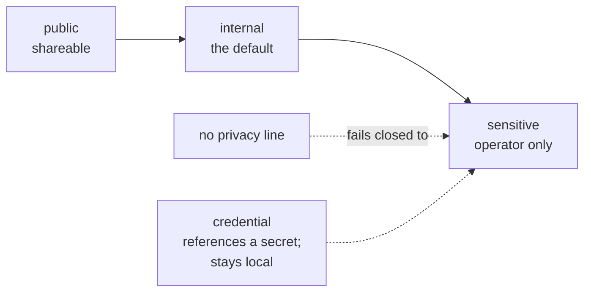
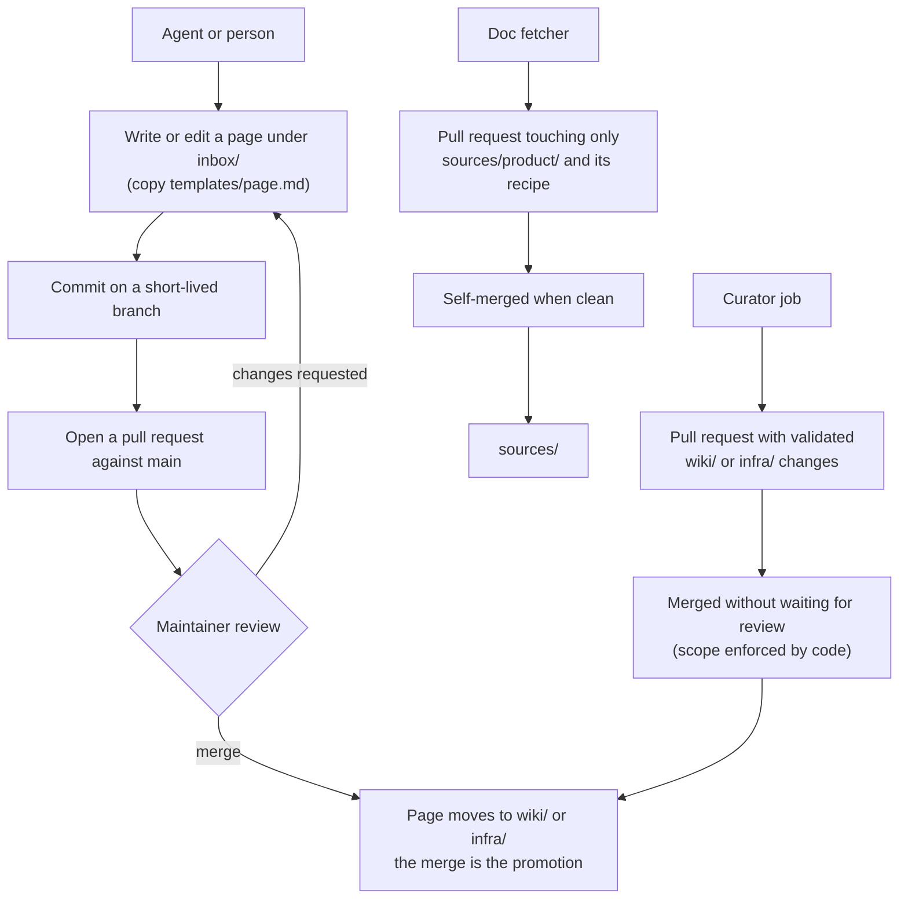

# Vault format

The vault is a Git repository of Markdown pages that also opens as an Obsidian vault. This page describes its layout, the frontmatter every page carries, the privacy levels, how a page becomes canonical, and the conventions for links and doc copies.

## Contents

- [Layout](#layout)
- [Page frontmatter](#page-frontmatter)
- [Privacy levels](#privacy-levels)
- [How a page becomes canonical](#how-a-page-becomes-canonical)
- [Writing pages](#writing-pages)
- [Wikilinks](#wikilinks)
- [Doc copies in sources/](#doc-copies-in-sources)

## Layout

| Path | Contents | Who writes it |
|---|---|---|
| `index.md` | Root map of contents | Navigation tooling only |
| `log.md` | Activity log | Navigation tooling only |
| `wiki/` | Curated pages, with `wiki/index.md` as the area hub | Merged pull requests, the curator |
| `infra/` | The fleet of record: hosts, roles, installs, with `infra/index.md` as the area hub | Merged pull requests, the curator |
| `inbox/` | Proposals waiting for review | Agents, on a branch |
| `sources/<product>/` | Markdown copies of vendor docs | The doc fetcher |
| `templates/page.md` | The page template | Maintainers |
| `docs/` | System documentation (this page) | Maintainers |
| `doclayer/` | The Python package | Maintainers |

`docs/`, `README.md` and `CLAUDE.md` document the repository; they are not vault pages and carry no frontmatter.

## Page frontmatter

Every vault page starts with YAML frontmatter. This is the frontmatter of `templates/page.md`, copied exactly:

```yaml
---
schema_version: 1
privacy: internal
source_origin: operator
source_lineage:
  - source:describe-where-this-came-from
tags:
  - area
  - topic
updated: 2026-06-30
concept_id: c-16752823
address: c-000011
title: page
---
```

| Field | Rule |
|---|---|
| `schema_version` | `1` |
| `privacy` | Mandatory. One of `public`, `internal`, `sensitive`, `credential` |
| `source_origin` | `operator`, `agent` or `external` |
| `source_lineage` | A list naming each source, for example `url:https://...` or `seed:demo-vault` |
| `tags` | A non-empty list |
| `updated` | The date of the last real change |
| `concept_id` | A stable id: `c-` plus 8 lowercase hex digits. Minted when the page is created, kept across renames, retired when the page is deleted |
| `address` | An optional navigation address. The doclayer does not validate it; the curator copies it unchanged when it updates a page |
| `title` | The page title |

Optional fields the doclayer reads: `product:` (the subject a page describes), `subject_type`, and `aliases:` (other names the router should match). Doc copies add `url`, `fetched_at`, `product` and `version`.

The curator enforces these rules on everything it publishes (`curator/validate.py:check_frontmatter`): all fields above present, valid `privacy` and `source_origin`, a valid `concept_id`, non-empty `tags`, a real `updated` date. A new curator page is `privacy: internal` with a fresh `concept_id`; an update keeps the page's `concept_id` and `privacy`.

## Privacy levels

`privacy:` is the contract that decides who may see a page. A consumer that serves pages to agents with different clearances orders the levels like this, and a page with no `privacy:` line counts as `sensitive`:



- A low-clearance agent profile sees `public` and `internal` pages.
- A high-clearance profile sees everything.
- `credential` marks a page that refers to a secret, such as where a key is stored. The page never contains the secret itself. Such pages stay on the local machine.

Pick the lowest level that is still true. Default new operational pages to `internal`. Never write a secret value into any page; credentials live in files with mode 600 outside the vault.

The doclayer package itself does not filter by privacy when it answers; it validates the field on what it publishes. Enforcing clearances is the job of the consumer that serves pages to agents.

## How a page becomes canonical



There is one way into `wiki/` and `infra/`: a merged pull request. People and agents propose through `inbox/` and a reviewed pull request. The curator is the one automatic writer; its scope is limited by code to `wiki/` and `infra/`, it never touches `index.md` or `log.md`, and it never deletes or renames a page (see [curator.md](curator.md#publication)). The fetcher self-merges only doc copies ([doc-fetcher.md](doc-fetcher.md)). Git history is the record of every promotion, and `git revert` is the rollback.

Pages left in `inbox/` are drafts. Readers should treat them as unreviewed.

## Writing pages

- One topic per section, so a reader can load only the section that answers a question.
- Put each fact with its source: `path@commit`, `URL @ fetch date`, or a dated live check.
- For an install, account or host, record facts in a `## Facts` table with three columns: Fact, Declared, Observed. Declared names its source in the cell. Observed holds `YYYY-MM-DD: value` from a live check, or `—`. The resolver reads only tables under a heading named "Facts" (`brainrepo:fact_rows`).
- Keep history in sections whose heading marks it as history, so it is not read as current state.

## Wikilinks

Link pages with `[[path/to/page]]`, without the `.md` extension, for example `[[wiki/example-app-deployment]]`. A link to a page that does not exist yet is a marker for something to write later, not an error. The curator checks that links on pages it publishes resolve to existing pages or pages in the same batch (`curator/validate.py:check_links`).

## Doc copies in sources/

- One folder per product: `sources/<product>/<slug>.md`. The folder name is the product's subject slug.
- Each copy has the standard frontmatter plus `url`, `fetched_at`, `product` and `version`.
- Only the latest copy is kept on disk; Git history holds earlier ones.
- Copies are written by `doclayer-fetch` from a recipe in `doclayer/recipes/`. Do not hand-edit them; the next refresh would overwrite the edit.
- The resolver flags a copy older than `DOC_LAYER_STALE_COPY_DAYS` (default 60) days.

The demo vault's `sources/example-cli/` holds two hand-written examples of the format.
