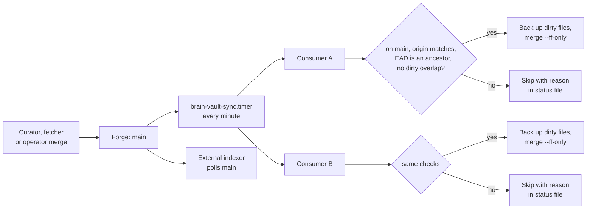

# Vault sync

A page merged on the forge must reach every machine that reads the vault: the reference clone the resolver reads on each agent machine, and any other registered consumer. `brain-vault-sync` (`vault_sync.py`) does this on a timer, independent of who published the change. It only fast-forwards, and it never loses a local edit.

## Contents

- [How a merged page reaches every machine](#how-a-merged-page-reaches-every-machine)
- [Registering consumers](#registering-consumers)
- [One reconciliation pass](#one-reconciliation-pass)
- [Status and backups](#status-and-backups)
- [Install](#install)
- [Recovery](#recovery)

## How a merged page reaches every machine



The resolver reads the clone named in `~/.config/doclayer/brain-repo` and captures one commit per request, so a fast-forward in the middle of a request cannot produce a wrong `path@commit` citation (`settings.Settings.brain_repo_selection`). The pointer is read on every request, so a long-running MCP server picks up a change without a restart.

## Registering consumers

Only clones listed in the config are touched. The sync never discovers checkouts on its own, and a development checkout you edit should not be registered.

```json
{
  "consumers": [
    {
      "repo": "/srv/consumer/brain-vault",
      "remote": "https://git.example.org/example/brain",
      "branch": "main",
      "state": "/srv/consumer/state/brain-vault-sync/consumer.json"
    }
  ]
}
```

This is `doclayer/deploy/vault-sync/consumers.example.json`. `repo` and `state` are absolute paths; `remote` must match the clone's configured `origin`; `branch` defaults to `main`. Each consumer is reconciled independently, so one failure does not stop the others.

## One reconciliation pass

`vault_sync:sync_consumer` does this for each consumer:

1. Take a lock file in Git's common directory (`brain-vault-sync.lock`). If another pass holds it, stop with an error.
2. Require the clone to be on the registered branch. It never checks out a branch.
3. Check that `origin` matches the registered remote (`vault_sync:validate_origin`). Git `insteadOf` rewrites are honored only if they keep the same host and repository path.
4. Refuse if a Git operation is in progress (merge, cherry-pick, revert, rebase, or an `index.lock`).
5. Fetch the branch and count how far the clone is behind.
6. Require the local `HEAD` to be an ancestor of the fetched commit. Diverged or locally-ahead history is reported and left alone.
7. List dirty paths. If any dirty path overlaps a path the update changes, stop and record those paths as `conflicting_paths`.
8. Back up before changing anything: the index, the exact bytes of every dirty or untracked file (mode 600), a manifest with SHA-256 checksums, and a Git ref `refs/brain-vault-sync/backups/<timestamp>` that keeps the old `HEAD` reachable.
9. Run `git merge --ff-only --no-overwrite-ignore`.
10. Check that the dirty files and staged entries are byte-for-byte as before. Any drift is reported, never silently repaired.

There is no stash, no reset, no automatic commit, and no conflict resolution. Unrelated dirty files, such as an appended log, survive the update.

## Status and backups

Each pass writes the consumer's `state` file:

```json
{
  "repo": "/srv/consumer/brain-vault",
  "checked_at": "...",
  "status": "current",
  "local_commit": "...",
  "canonical_commit": "...",
  "lag_commits": 0,
  "error": null,
  "last_success_at": "...",
  "backup_path": "...",
  "preserved_paths": ["log.md"]
}
```

`status` is `current` or `error`; `error` names the reason, and `conflicting_paths` lists overlaps. `brain-vault-sync --config consumers.json --status` prints every consumer's last status. The command exits 0 only when every consumer is `current`. Backups are kept until you delete them.

## Install

The units are in `doclayer/deploy/vault-sync/`:

- `brain-vault-sync.service`: a oneshot running `brain-vault-sync --config ~/.config/brain-vault-sync/consumers.json`, with `TimeoutStartSec=300`, `UMask=0077`, `NoNewPrivileges=true`, `PrivateTmp=true`.
- `brain-vault-sync.timer`: `OnCalendar=*-*-* *:*:00` (every minute), `RandomizedDelaySec=10`, `Persistent=true`.

On the worker host, after deploying the package, run from an agent machine:

```bash
doclayer/deploy/vault-sync/install-worker.sh worker1
```

It backs up any existing config and units, installs `consumers.example.json` as the config if none exists, installs the units, enables the timer, runs a first pass and prints the status.

On an agent machine, `install-workstation.py` creates a dedicated reference clone at `~/.local/share/doclayer/brain-reference`, registers only that clone, writes the pointer file `~/.config/doclayer/brain-repo`, and installs the same timer:

```bash
doclayer/.venv/bin/python doclayer/deploy/vault-sync/install-workstation.py
systemctl --user status brain-vault-sync.timer
doclayer/.venv/bin/brain-vault-sync --config ~/.config/brain-vault-sync/consumers.json --status
```

It refuses unrelated existing directories, origins or branches, keeps other registrations, and backs up what it replaces under `~/.local/state/brain-vault-sync/deployment-backups/`. The workstation unit it renders sets `PrivateTmp=false`, because some Git-over-ssh authentication setups fail inside a private `/tmp`. The sync uses the clone's existing Git authentication with interactive prompts turned off (`vault_sync:git` sets `GIT_TERMINAL_PROMPT=0`).

## Recovery

| Status error | What to do |
|---|---|
| `local changes overlap canonical update` | Resolve the listed paths by hand, then wait for the next pass |
| `local history diverges or is ahead` | Reconcile through normal reviewed Git work. Do not reset to make the status green |
| `another vault reconciliation holds the lock` | A pass is running; wait for it |
| `Git operation in progress` | Finish or abort the merge or rebase in that clone |
| `consumer must remain on main` | Check out the registered branch by hand |

To stop automation: `systemctl --user disable --now brain-vault-sync.timer`, and wait for a running pass to finish before any manual Git work. To undo a published page, revert it on the forge through the normal publication flow; never reset a consumer.
